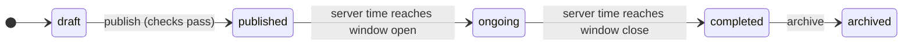
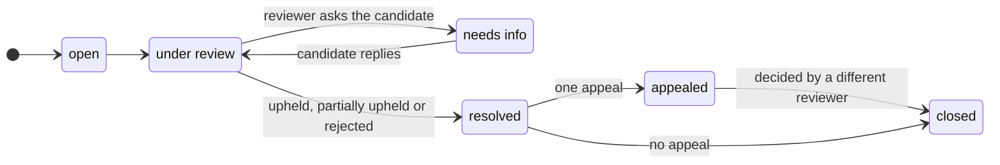

# Athena: Requirements Analysis

- **Product:** Athena, a multi-tenant Secure Examination Management System
- **Team:** DevQueue
- **Event:** Technoverse 5.0 Web-e-Thon, COMSATS University Lahore, 27–28 November 2026
- **Source:** *Web-e-Thon Problem Statement* (7 pages), cited as "PDF §n" using its own section numbers
- **Companion:** [02-technical-analysis.md](02-technical-analysis.md) (constraints, risks, quality attributes)
- **Status:** analysis baseline, kept in step with the build. Every resolution is marked **Decided** (part of our design decisions: the decision record, or the shared contracts and code already written) or **Proposed** (recommended by this analysis, to be confirmed or amended during the build). Section 3.2 lists this document's proposals in one place; the companion document marks its own in its Status columns.

## How this document covers the evaluation criteria

| Criterion | Where it is addressed |
|---|---|
| Case study analysis | Section 1 |
| Analyzing requirements (unclear, incomplete, ambiguous, contradictory) | Section 3: 53 issues, each classified and resolved |
| Completion of requirements | Section 2: every bullet of PDF §3.1–§3.8, all 8 secondary features and all 5 innovation challenges have a stable ID and testable acceptance criteria |
| Front-end and back-end validations | Section 2.10 (validation matrix); NFR-VAL-1 to NFR-VAL-5 |
| Visual design, simplicity, consistency | NFR-UX-1 to NFR-UX-6 |
| Constraints, technical analysis, technology selection | [02-technical-analysis.md](02-technical-analysis.md) |

## Contents

1. [Case study analysis](#1-case-study-analysis)
2. [Requirements catalogue](#2-requirements-catalogue)
3. [Ambiguities, gaps and contradictions](#3-ambiguities-gaps-and-contradictions)
4. [Assumptions](#4-assumptions)
5. [Out of scope](#5-out-of-scope)
6. [References](#6-references)

---

## 1. Case study analysis

### 1.1 The problem

An online exam has to be as trustworthy as a hall exam while it runs on things nobody controls: the candidate's device, network, power supply and surroundings. The PDF names four challenges: academic integrity, fairness, network reliability and the management of large numbers of candidates. It asks for a full-stack application in which institutions and competition organizers create, conduct, monitor and evaluate online exams, with reliable and accessible workflows and at least one innovation challenge (PDF §01).

We read the case against the setting where Athena would be used first: universities and competition organizers in Pakistan. There, each challenge has a sharper edge.

- **Power and connectivity.**
  - Load-shedding and unstable mobile data can cut a candidate off mid-exam through no fault of their own.
  - Many candidates own only a phone.
  - Campus exams often run on shared lab computers.
- **Paper leaks.** Leaks recur in board exams and entry tests. In September 2024 the MDCAT (the medical and dental college admission test) in Sindh was compromised.
  - According to the investigators, the paper was shared in WhatsApp groups about 14 hours before the test, with about 75 % of the questions leaked.
  - The Sindh High Court ordered a retest across the province ([Dawn][dawn], [Geo News][geo]).
- **AI tools.** AI tools can answer many question types in seconds. The usual responses, webcam proctoring and AI-text detectors, harm the people they should protect.
  - Webcam proctoring is invasive, and it needs bandwidth many candidates do not have.
  - AI-text detectors misjudge non-native English writing. In one study they labelled more than half of the TOEFL essays written by non-native speakers as AI-written ([Liang et al., 2023][liang]).
  - For most Pakistani candidates, English is a second language.
- **Scale and fairness.** Large cohorts and flexible windows push examiners towards randomized papers drawn from question pools, and pools differ in difficulty. In admissions and competitions, a fraction of a mark changes a rank.

### 1.2 Stakeholders and their goals

| Stakeholder | Role in Athena | Goals | What failure costs them |
|---|---|---|---|
| Platform operator (DevQueue) | Platform Administrator | Onboard and suspend tenants; keep tenants isolated; stay available during exam windows | A single cross-tenant leak ends trust in the platform |
| Institution exam office, competition organizing committee | Organization Admin | Decide who holds which role; oversee every exam in the tenant; rely on an audit trail | Wrong access; disputes that records cannot settle |
| Faculty and question setters | Examiner | Build exams quickly from a reusable bank; give every candidate a paper of equal difficulty; see what happens live; publish with confidence | Flawed questions, unequal papers, public disputes |
| Teaching assistants | Grader | Grade written answers quickly and consistently; credit method as well as the final answer | Inconsistent marks and regrading |
| Invigilators | Proctor | Watch live status; answer clarifications; broadcast announcements; note incidents without accusing anyone | False accusations; problems noticed too late |
| Students and participants | Candidate | Clear access; a calm, accessible workspace; no lost work; a fair paper; timely results; a fair way to contest them | Lost answers, lost time, opaque results |
| Candidates who need accommodations | Candidate with an accommodation | Extra time and a readable display, without being singled out | Being disadvantaged by default settings |
| Admissions offices, employers, sponsors | Public verification page | Confirm that a result report is genuine | Forged reports, or more personal data exposed than needed |

### 1.3 Why the stated challenges matter

| Challenge (PDF §01) | Why it matters | How Athena responds |
|---|---|---|
| Academic integrity | If cheating is easy, a result certifies nothing. Heavy surveillance creates new harms: loss of privacy, accessibility barriers and false accusations. | Privacy-first integrity (IC-5.1); indicators, never verdicts (FR-3.6.3); leak tracing (IC-5.5) |
| Fairness | Unequal randomized papers, inconsistent marking and time lost to failures all change ranks for reasons unrelated to ability. | Balanced papers (IC-5.2); attempt snapshots (FR-3.3.3); defined marking rules (section 2.4); disputes and global remedies (IC-5.4) |
| Network reliability | Candidates lose answers or time through no fault of their own. The obvious fix, trusting the device, opens a door to extra time. | Local-first journal and a server-fixed deadline (IC-5.3, NFR-INT-1); network-aware interface (SF-4.1) |
| Large numbers of candidates | Manual enrollment, grading and reporting do not scale, and they introduce errors. | Bulk import (SF-4.4); auto-grading (FR-3.7.1); auto-finalization (FR-3.5.3); analytics (SF-4.5); multi-tenancy |

### 1.4 Tensions the design must balance

| Tension | How we balance it |
|---|---|
| Integrity vs privacy | We use no webcam, microphone or screen recording. Browser signals are recorded as indicators with a review priority. For written answers, we show how the text was composed instead of guessing who wrote it. |
| Fairness vs variation | Papers are balanced to a common expected score within a tolerance. The optimizer swaps only the questions it must, and the pre-publication simulation shows that papers still differ. |
| Resilience vs extra time | Work is saved locally and synced later, but the server fixes the deadline at start. Answers that arrive late wait for a human decision. Only an outage that the server verifies itself extends time. |
| Transparency vs secrecy | Candidates get evidence-backed disputes, versioned results, a submission receipt and a verifiable report. Answer keys stay on the server, and public verification shows minimal, masked data. |
| Retention vs minimization | The academic record is kept, and the grade ledger is append-only. Behavioral data is limited to the exam page during the attempt (A-37). |

### 1.5 From the PDF's roles to Athena's roles

| PDF role (PDF §02) | Athena role | Scope |
|---|---|---|
| Administrator: "overall platform operations" | Platform Administrator | Whole platform: onboards and suspends tenants. Seeded accounts that can only sign in; there is no public sign-up. |
| Administrator: "manage users, roles, access permissions" | Organization Admin | One tenant: members, roles, custom roles, permissions, oversight of every exam in the tenant |
| Examiner | Examiner, with Grader (teaching assistant) and Proctor for delegated work | The exams they are assigned to, as owner, co-examiner, grader or proctor |
| Candidate | Candidate | Exams they are enrolled in, and their own attempts and published results |

### 1.6 Participant-defined challenge (IC-5.5): exam paper leaks

PDF §5.5 asks why the problem matters, who it affects and how the solution addresses it.

- **Why it matters.**
  - A leak invalidates an exam for everyone and rewards dishonest candidates.
  - The usual remedy, a retest, costs every honest candidate time, money and stress.
  - The 2024 Sindh MDCAT shows the scale: a whole province sat a national admission test again.
- **Who it affects.**
  - Candidates.
  - Institutions and organizers, who bear the cost and the damage to their reputation.
  - Regulators.
- **Why online exams are exposed too.**
  - Flexible windows let early starters pass questions to later starters.
  - Screenshots and phone photos travel instantly on messaging apps.
- **How Athena addresses it.**
  - Every candidate's rendition of the paper carries an invisible zero-width-character fingerprint and a faint visible watermark code. The Leak Tracer can find the source attempt of a leaked copy, and the known traceability deters leaking.
  - Per-attempt randomization and question pools ("draw N of M") make any single leaked paper less useful.
  - Question exposure tracking shows how widely each question has been seen, so over-exposed questions can be retired.
- **Limits.**
  - Retyping removes the invisible fingerprint; the visible code survives screenshots and photos.
  - A leak by staff before the exam cannot be traced through candidate renditions. Online delivery removes the printing and handling chain, and exam-level assignments limit who can see a paper.

---

## 2. Requirements catalogue

### 2.1 Conventions

- **IDs are stable.**
  - FR-3.x.y is bullet y of PDF §3.x.
  - SF-4.x and IC-5.x follow PDF §04 and §05.
  - NFR-* come from PDF §06 and §08, and DEL-7.x from PDF §07.
- **Mandatory scope.** All FR and SF items are mandatory (PDF §03, §04). The PDF requires at least one IC (PDF §05); we commit to all five.
- **Terms used in acceptance criteria.**
  - **Refused**: the API returns an error, changes nothing and returns no protected data, and the interface explains why in plain language.
  - **Real attempt**: an attempt that is not a sandbox attempt.
  - **Staff**: any tenant role other than Candidate.
  - **Server time**: the API server's clock. Device clocks are never trusted.
- **References.** (A-nn) points to the resolution in section 3 that an acceptance criterion depends on. "Section n" refers to this document.

### 2.2 Glossary and lifecycles

| Term | Meaning |
|---|---|
| Tenant | An organization of type `institution` or `competition` |
| Membership | A user's link to one organization. A user is one global identity with a membership per organization, and each membership carries one role. |
| Role | A named set of permission keys. System roles per tenant: Organization Admin, Examiner, Grader, Proctor, Candidate. Organization Admins can create custom roles. |
| Exam assignment | A staff member's link to one exam as owner, co-examiner, grader or proctor |
| Window | The period in which attempts can start and answers are accepted; it opens and closes at fixed instants |
| Duration | The working time of one attempt |
| Deadline | The instant an attempt ends. The server fixes the deadline at start: min(start + duration × accommodation multiplier + extra minutes, window close). Every write enforces it. |
| Question version | An immutable version of a bank question. Editing creates a new version, and each exam pins the version it uses. |
| Snapshot | The attempt's own copy, taken at start, of its questions, marks, marking scheme and answer key |
| Sandbox attempt | A staff preview attempt, flagged `is_sandbox` and excluded from all statistics |
| Indicator | A browser signal recorded with a review priority; never a verdict |
| Held answer | An answer that reached the server only after the deadline: never counted automatically, held for an examiner's decision with an audit entry |
| Result version | One publication of an exam's results; unpublish and republish are recorded as versions |
| Grade ledger | The append-only, hash-chained record of every score change, with actor and reason |
| Global remedy | A question-level correction applied alike to every affected attempt. Dropping a question voids it on each attempt instead of deleting it. |
| Rendition | One candidate's copy of the paper as displayed, carrying that attempt's fingerprint and watermark code |

**Exam lifecycle (decided):** draft → published (scheduled) → ongoing (window open) → completed (window closed) → archived. The effective status is derived from server time. In the code, the stored status is draft, published or archived, and one shared function derives the phase every screen shows.



**Results lifecycle (decided):** unpublished → published, with unpublish and republish recorded as versions.

**Attempt lifecycle (decided):** in progress → submitted.
- A submission is made by the candidate, at time-out, by a proctor, or by an offline sync.
- If the deadline passes while the candidate is offline, the server still submits the attempt at its deadline with the answers it accepted. The browser seals its journal, and newer answers that arrive with it later are held for an examiner (A-24). The status enum also has an *awaiting sync* value, which the monitor can display but the API does not set today.

**Dispute lifecycle (decided):** open → under review → needs info → resolved (upheld / partially upheld / rejected), with one appeal to a different reviewer. The code adds two refinements: *appealed* for the single appeal, and *closed* as the final state.



### 2.3 Functional requirements (PDF §3.1–§3.8)

#### PDF §3.1 Authentication & Authorization

| ID | Requirement | Acceptance criteria |
|---|---|---|
| FR-3.1.1 | Administrators, examiners, candidates and the other staff roles sign in securely, and each gets an experience suited to its role. | 1) Passwords are stored only as argon2id hashes; no response or log line contains a password.<br>2) Signing in sets an httpOnly, SameSite=Lax cookie (Secure in production) that holds a random 256-bit token; the database stores only the token's SHA-256 hash.<br>3) After sign-out or revocation, the very next request with the old cookie is treated as signed out.<br>4) Sign-in is rate limited per IP address and email, and five consecutive failures lock the account for 15 minutes (an Organization Admin's password reset clears the lock). A wrong password and an unknown email get the same message after the same hashing work, so neither the message nor its timing reveals whether the account exists; only the lock notice does (see [02-technical-analysis.md](02-technical-analysis.md), R-32).<br>5) Navigation and the home screen show only what the active membership's permissions allow; a Candidate sees no authoring, grading or monitoring area (A-06). |
| FR-3.1.2 | Organization Admins manage user accounts, memberships and role assignments, and the API enforces every permission instead of the interface merely hiding elements. | 1) An Organization Admin can add and suspend members, give each membership a role, and create custom roles from permission keys.<br>2) A permission change applies from the member's next request, without signing in again.<br>3) A request built outside the interface (for example with curl) for an action the caller's role lacks is refused.<br>4) Membership and role changes are written to the audit log with actor, target and time.<br>5) Platform Administrators onboard and suspend tenants; members of a suspended tenant can no longer use it. |
| FR-3.1.3 | Examiners and candidates (and graders and proctors) reach only the exams, records and actions they are authorized for. | 1) Every query is scoped to the caller's active organization; a request for another tenant's resource is refused as not found (A-05).<br>2) An Examiner without an assignment on an exam cannot read or change its paper, enrollments, attempts or results; Graders and Proctors are limited to the exams they are assigned to. Organization Admins oversee every exam in their tenant.<br>3) A Candidate can read only exams they are enrolled in, and only their own attempts and published results; changing an ID in a request to reach another candidate's attempt is refused.<br>4) These checks run in API middleware and services, so they hold for every client. |

#### PDF §3.2 Examination Management

| ID | Requirement | Acceptance criteria |
|---|---|---|
| FR-3.2.1 | Examiners create and configure exams with title, instructions, schedule, duration, total marks and settings. | 1) A draft needs only a title; publishing needs a window that opens before it closes, a positive duration and positive total marks. The form shows each error beside its field.<br>2) The API validates with the same shared schema, so an invalid payload sent directly is refused with field-level messages and nothing is stored.<br>3) Every setting has a safe default and is listed in A-07 (sections and pools, shuffling, navigation, late entry, access code, marking defaults, integrity, results, grading and fairness options).<br>4) Schedule times are entered and shown with an explicit time zone and stored as UTC instants (A-13). |
| FR-3.2.2 | Exams move through draft → published (scheduled) → ongoing (window open) → completed (window closed) → archived, derived from server time, and candidates cannot access an exam before it is available. | 1) Every screen shows the phase computed from server time and the window; nobody starts or stops an exam by hand.<br>2) Draft exams are not listed to candidates, and a direct request for one is refused (A-12).<br>3) Before the window opens, an enrolled candidate sees the lobby (title, schedule, duration, instructions, section outlines) but no question content; a start request is refused (A-12).<br>4) After the window closes, no attempt can start and no answer is accepted, except in attempts extended for a verified server outage (A-26) and sealed offline journals held for review (A-24).<br>5) An archived exam is read-only and stays available for review (FR-3.8.3); an exam cannot be archived while candidates are still writing or syncing. |
| FR-3.2.3 | Examiners review an exam before publication and manage their exams through one interface. | 1) A review screen shows every section, question, mark and marking scheme, the settings, the schedule with its time zone, the enrolled count and the computed paper total.<br>2) Publishing is refused, with a specific message and a suggested fix where one exists, when the exam has no questions, the computed total differs from the declared total (A-10), a pool draws more questions than it holds or mixes different marks, the window has already closed, or the window is shorter than the duration (A-11). A question cannot be saved unless it passes its type's validation.<br>3) The review screen warns about empty sections, questions without a rubric, questions traced in a leak (IC-5.5) or archived in the bank, an exam with no candidates, and a window that opens in the past. It should also warn when an accommodated candidate's time cannot fit in the window (A-11), or when the pools cannot meet the balancing tolerance (IC-5.2).<br>4) The sandbox preview (SF-4.3) and the fairness simulation (IC-5.2) start from the review screen.<br>5) An examiner's exam list shows only exams they are assigned to, with phase, window and attempt counts. |

#### PDF §3.3 Question Management

| ID | Requirement | Acceptance criteria |
|---|---|---|
| FR-3.3.1 | A reusable, tenant-scoped question bank organizes questions by topic and difficulty, and questions can be created, edited and assigned to exams. | 1) Every question has a type, content, a topic and a difficulty label (easy, medium or hard).<br>2) The bank can be filtered by topic, difficulty and type.<br>3) A bank question can be used in several exams and is never visible to another tenant.<br>4) Questions are versioned: saving an edit creates a new version, and each exam keeps the version it pinned, so an edit never changes a live or graded exam or an attempt already started (A-14). When two people edit the same question, the later save is refused with a version conflict instead of overwriting the first. |
| FR-3.3.2 | Single-answer MCQs, multiple-select and written-response questions are supported, together with our further types, each with an appropriate marking scheme. | 1) Each type's handler validates content on save. For example, a single-choice question needs at least two options and exactly one correct option, and a multiple-select question needs at least two options and at least one correct option, each listed once.<br>2) Each multiple-select question uses one scheme: all-or-nothing, partial, or partial with penalty floored at 0 (section 2.4).<br>3) Single choice supports optional negative marking (the same setting also applies to true/false).<br>4) Any question can enable "show your working", which adds method marks graded from a rubric, separate from the final-answer marks. |
| FR-3.3.3 | Objective questions and answer choices can be randomized, while the question assignment and marking scheme are preserved for an active attempt. | 1) With shuffling on, question and option order are drawn per attempt from a seed, and each candidate sees the same paper after a refresh, on another device or after a server restart (A-15).<br>2) The snapshot taken at start stores the drawn questions, their order, option order, marks, marking scheme and answer key; editing the bank later changes neither the attempt's display nor its grading.<br>3) Responses are matched by option identity, so shuffling never changes correctness.<br>4) An ordering question is never presented already in its solved order. |

#### PDF §3.4 Candidate Management

| ID | Requirement | Acceptance criteria |
|---|---|---|
| FR-3.4.1 | Examiners enroll candidates in exams and view enrollment information. | 1) An examiner assigned to the exam can enroll Candidate members one at a time or from an import (SF-4.4); enrolling someone twice changes nothing and says so.<br>2) The enrollment list shows each candidate's state: not started, in progress, submitted, or absent (window closed without an attempt).<br>3) Accommodations (time multiplier, extra minutes, a note) are set per enrollment and applied when the attempt starts.<br>4) Only Candidate memberships of the same tenant can be enrolled (A-19). |
| FR-3.4.2 | Candidates get a clear view of their available, upcoming and completed exams, with instructions and access status. | 1) The candidate home groups exams into available now, upcoming and completed.<br>2) Each exam shows window, duration, total marks, question count and the candidate's effective time limit including accommodations, and, when it cannot be entered, the reason (for example "Opens 27 Nov, 10:00 PKT" or "Window closed").<br>3) Times appear in the candidate's time zone with its label; countdowns use server time.<br>4) Completed exams show submitted, absent, result pending or result published. |
| FR-3.4.3 | Exam entry is restricted to eligible candidates within the availability window. | 1) The API starts an attempt only when every eligibility condition in A-20 holds, including the access code and the late-entry limit when the exam sets them; each failed condition has its own plain-language reason.<br>2) The pledge must be accepted before an attempt starts (IC-5.1).<br>3) The server fixes the deadline at start: min(start + duration × accommodation multiplier + extra minutes, window close). The start screen shows the time this leaves (A-08).<br>4) Requests outside the window are refused, whatever the device clock says. |

#### PDF §3.5 Examination Interface

| ID | Requirement | Acceptance criteria |
|---|---|---|
| FR-3.5.1 | The workspace presents questions, marks, remaining time and navigation controls accessibly, and distinguishes answered, unanswered and marked-for-review questions. | 1) Each question shows its marks; the navigator shows each question's state with an icon and a text label, not color alone.<br>2) Remaining time is shown in the style the candidate chose (always, minimal, or only in the last five minutes; SF-4.7).<br>3) Navigation is free, or forward-only when the exam sets linear navigation (A-21).<br>4) Every action (moving between questions, answering, flagging, submitting) works with the keyboard alone, with visible focus; controls have accessible names, and the page stays usable at 200 % zoom.<br>5) Flagging a question never changes or removes its answer (A-22). |
| FR-3.5.2 | Answers save automatically, and saved progress and remaining time survive a refresh or a return. | 1) Each change goes to the local journal at once and is synced in the background with a per-question revision; the save status is always visible (SF-4.1).<br>2) After a refresh, a browser restart or a move to another device, the attempt reopens with every answer the server has acknowledged, plus, on the same device, any not yet synced.<br>3) On return, remaining time equals the server deadline minus server time; time keeps running while the candidate is away (A-23). |
| FR-3.5.3 | Candidates review their progress and submit; the time limit is enforced, and at expiry the attempt is finalized with the answers accepted within the permitted period. | 1) Before submitting, the candidate sees how many questions are unanswered or flagged and confirms.<br>2) Submitting twice, or retrying after a lost response, returns the same finalized result.<br>3) On submission the candidate gets a receipt code, an HMAC over the final answers, which later proves exactly what was submitted.<br>4) Every write enforces the deadline; writes arriving later never change the attempt (A-24).<br>5) A background job finalizes expired attempts even when the candidate's browser is closed, using exactly the answers the server accepted by the deadline. |

#### PDF §3.6 Examination Monitoring

| ID | Requirement | Acceptance criteria |
|---|---|---|
| FR-3.6.1 | Examiners see active attempts, their progress and relevant events or incidents. | 1) For each enrolled candidate, the monitoring view shows attempt state, answered and flagged counts, time remaining, when the candidate was last seen, online status, round-trip time, and indicators grouped by review priority.<br>2) Changes appear live over Socket.IO, and the view is correct again after a reconnect.<br>3) Only staff assigned to the exam, or with tenant-wide oversight, can open it (A-05).<br>4) Sandbox attempts are not counted (A-40). |
| FR-3.6.2 | Examiners monitor exam status and communicate announcements to candidates during an exam. | 1) The exam header shows phase, time to close and how many candidates have not started, are in progress or have submitted.<br>2) An announcement (normal or urgent) reaches every connected candidate within seconds. It does not take focus from the answer being typed, and screen readers announce it.<br>3) A candidate who was offline or starts later still receives every announcement (A-30).<br>4) Staff answer candidates' clarification requests privately or for everyone, and can extend an attempt's time or force-submit it; each intervention is recorded on the attempt's timeline with its reason. |
| FR-3.6.3 | Relevant incidents are recorded and presented for review, and monitoring indicators are never treated as conclusive evidence of misconduct. | 1) Indicators (focus loss, fullscreen exits, copy and paste, context-menu, print and multiple-display signals) are recorded with server time and a review priority; connectivity changes, device switches, time extensions and outage compensation appear on the attempt's timeline (A-28).<br>2) Screens call these indicators, never violations; no indicator triggers a penalty, a submission or a score change.<br>3) A reviewer records an outcome (no concern, follow up, escalated) for each indicator, and the decision is audited (A-29).<br>4) Before starting, the candidate is told what is recorded (IC-5.1). |

#### PDF §3.7 Evaluation & Grading

| ID | Requirement | Acceptance criteria |
|---|---|---|
| FR-3.7.1 | Objective responses are graded automatically under the configured marking scheme, including the rules for multiple-select answers. | 1) Each auto-gradable response is scored by its type's handler against the key and scheme in the attempt snapshot.<br>2) Scores match the rules and worked examples in section 2.4 (the asserted cases are unit tests).<br>3) Grading the same snapshot again gives identical scores.<br>4) An unanswered question scores 0, never a negative mark. |
| FR-3.7.2 | Examiners and graders review and manually grade written responses, with validation against the assigned marks. | 1) The grading view shows the response, any attached working, and the rubric with each criterion's maximum; candidate identities are hidden from graders by default (anonymous grading).<br>2) A typed score outside the range from 0 to the part's maximum is refused by the API. A rubric award (criterion points, which may be deductions, plus an optional adjustment) is clamped to that range, and its ledger entry records the clamping (A-31).<br>3) When "show your working" is on, method marks and final-answer marks are awarded separately.<br>4) Every award is appended to the grade ledger with grader, time and reason; identical answers can be graded together, with one entry per answer.<br>5) Changing a rubric criterion's points re-scores every answer graded with it, keeps each grader's adjustment, and records the change in the ledger. |
| FR-3.7.3 | Total scores are calculated accurately, the grading state stays consistent, and examiners review results before publication. | 1) The server recomputes every item score and the attempt total inside the grading transaction; totals can never be typed in (A-32).<br>2) Each attempt shows its grading state: pending, partial or complete.<br>3) A results review screen shows the score distribution, per-question statistics, flagged items (such as a possible miskey) and the number still ungraded.<br>4) Publication is refused while any answer part is ungraded, an attempt is still running, the window is open or offline answers are held, unless the publisher overrides with a written reason of at least 10 characters, which is recorded with the open items. Open disputes and high-priority indicators are shown as warnings (A-32). |

#### PDF §3.8 Results & Analytics

| ID | Requirement | Acceptance criteria |
|---|---|---|
| FR-3.8.1 | Examiners publish results in a controlled manner, and candidates see only their own published results unless authorized otherwise. | 1) Results stay unpublished until a user whose role allows it publishes them; until then, no candidate-facing response includes a score (A-33).<br>2) Unpublishing hides results again and supersedes the reports already issued; republishing creates a new version, and every version records actor and time.<br>3) A candidate's request for another candidate's result is refused; staff need result access to that exam (A-34).<br>4) A published result shows the total, per-question marks, the candidate's own answers and feedback; correct answers appear only if the exam enables it (A-35). |
| FR-3.8.2 | Exam-level performance summaries and candidate-level scores are presented from actual submission data. | 1) Over percentage scores, the summary shows the mean, median, highest, lowest and standard deviation, the number passed and the pass rate against the exam's pass percentage, and a ten-band distribution. The analytics add per-section and per-topic averages and the paper's reliability (A-36).<br>2) Only finalized real attempts are included.<br>3) Every summary figure can be recomputed by hand from the candidate-level table. |
| FR-3.8.3 | Completed attempts and their results are retained for later review by authorized users. | 1) Normal operation never hard-deletes finalized attempts, snapshots, responses, scores, ledger entries or result versions; archiving only makes them read-only (A-37).<br>2) Authorized staff can open any past attempt and see exactly the paper the candidate saw (from the snapshot) and what they answered.<br>3) Any UPDATE or DELETE on the grade ledger fails at the database level. |

### 2.4 Marking rules

These rules are implemented in the question-type handlers (**Decided**). Cases marked "asserted" are checked by the handlers' unit tests. Notation: *M* is the question's marks, *C* is the set of correct options, and *S* is the set of options the candidate selected.

**Common to every type**
- An unanswered question scores 0 and is never penalized.
- Each item score is rounded once to three decimal places, and marks are stored as exact decimals (`numeric`).
- The attempt total is the sum of the item scores, floored at 0. Negative marking can reduce an item, but never the whole paper, below zero.

**Single choice and true/false.** A correct answer scores *M*. A wrong answer scores 0, or minus the negative-marking fraction of *M* when the exam enables it. Asserted case: with *M* = 2 and a fraction of 0.25, a correct answer scores 2, a wrong one −0.5, and a blank 0.

**Multiple select.** Let *right* be the number of correct options picked and *wrong* the number of incorrect options picked. Let the wrong pool be the number of options that are not correct.

```text
all-or-nothing        M  if S = C, otherwise 0
partial               0  if any wrong option is picked, otherwise  M × right / size(C)
partial with penalty  M × max(0, right / size(C) − wrong / size(wrong pool))      (the exam default)
```

Worked examples: five options A–E, correct options {A, B}, so the wrong pool holds 3. This is the unit tests' setup. They assert six cells: all-or-nothing on "A, B" and "A", partial on "A" and "A, C", and penalty on "A, B, C" and "everything". They also assert that a blank scores 0. Scores are shown as fractions of *M*.

| Selected | All-or-nothing | Partial | Partial with penalty |
|---|---|---|---|
| A, B (exact) | 1 | 1 | 1 |
| A | 0 | 1/2 | 1/2 |
| A, C | 0 | 0 | 1/6 |
| A, B, C | 0 | 0 | 2/3 |
| A, B, C, D, E (everything) | 0 | 0 | 0 |
| B, C, D | 0 | 0 | 0 |
| nothing | 0 | 0 | 0 |

Neither partial scheme rewards selecting every option. The two differ in how they treat a wrong pick:
- **Partial** voids the question when any wrong option is picked, and rewards an incomplete but clean selection. This is the stricter choice where guessing is common.
- **Partial with penalty** deducts each wrong pick in proportion to the size of the wrong pool, so a mostly right answer with one slip keeps part of its credit.

The authoring interface should describe each scheme by this behavior, not by its name alone.

**Numeric.**
- An answer is correct when its distance from the key is within the tolerance. The tolerance is either absolute (a fixed amount) or relative (a fraction of the key's magnitude), and scoring is *M* or 0.
- Asserted cases: with key 9.81 and an absolute tolerance of 0.05, the answer 9.8 earns full marks; with key 100 and a relative tolerance of 0.01, the answer 102 earns 0.
- In a parameterized question, each variable's value is drawn per attempt within the examiner's range and step, and substituted into the stem. The key is computed on the server from the formula, so it never reaches the browser.

**Short text and fill-in-the-blanks.**
- A response is compared with each accepted answer after trimming and collapsing whitespace, case-insensitively unless the question is case-sensitive.
- Short text scores *M* or 0.
- Fill-in-the-blanks scores *M* × correct blanks ÷ blanks, and an empty blank is never correct.

**Matching.** *M* × correctly matched prompts ÷ prompts.

**Ordering.** *M* × L ÷ n, where n is the number of items and L is the length of the longest run of items in the correct relative order (the longest increasing subsequence), so one misplaced item costs about one item. Asserted case: with key A B C D, the response B A C D has L = 3, so it scores 3/4 of *M*.

**Long written answer and code.** These are graded manually against a rubric (FR-3.7.2), and candidate code is never executed.

**Show your working.** The question's method marks are added to its answer marks. The answer part is graded by the type's rule. The method part is awarded by a grader from the method rubric, and the item stays pending until both parts are graded.

### 2.5 Secondary features (PDF §04)

| ID | Requirement | Acceptance criteria |
|---|---|---|
| SF-4.1 | **Network-aware interface.** Connectivity problems and the status of saving and synchronization are detected and shown clearly. | 1) A save-status control always shows one of: saved; saving; offline, with the number of answers kept on this device; reconnecting; sync failed, retrying (A-38).<br>2) An offline banner appears soon after requests start failing and clears once the sync queue has drained; detection does not rely only on the browser's online flag.<br>3) After reconnecting, the queue drains without any action by the candidate, and the server applies each change once (revisions).<br>4) Staff screens show a clear message and a retry option when a request fails. |
| SF-4.2 | **PDF reports.** Readable PDF reports are produced from actual exam and candidate data, with access restrictions. | 1) Two reports: a candidate result report and an exam summary report, rendered on the server from live data with @react-pdf/renderer.<br>2) A candidate downloads only their own result report, and only after publication; staff need report access to the exam; no report is served from a public URL (A-39).<br>3) Report text is selectable, and pages fit A4.<br>4) Each candidate report carries its verification code and QR code (SF-4.6). |
| SF-4.3 | **Examination sandbox.** Examiners preview and experience an exam as a candidate, without affecting real submissions, results or statistics. | 1) Assigned staff start a sandbox attempt from the review screen, and it runs through the same delivery code that candidates use (A-40).<br>2) Sandbox attempts are flagged `is_sandbox`; results, summaries, question analytics, difficulty estimates, collusion analytics and exposure counts are identical before and after a sandbox run.<br>3) On submission, the sandbox shows the examiner the auto-graded score at once, so the answer key can be checked. |
| SF-4.4 | **Bulk data import.** Candidate records and questions are imported from CSV or JSON, validated, and errors are reported clearly. | 1) CSV and JSON are both accepted, for candidates and for questions of every type, in a documented format.<br>2) A dry run validates every row against the shared schemas and lists the row number, field and message of each error, writing nothing.<br>3) The commit runs as one transaction and validates every row again, so it writes what the dry run showed. Rows with errors are never written: a people import with errors commits only when the importer chooses to import just the valid rows, and a question import writes only its valid rows. Importing the same file again creates no duplicates (A-41).<br>4) Files over the size limit, or with more than 1,000 people or 500 questions, are refused with a clear message. |
| SF-4.5 | **Question analytics.** Each question's performance is analyzed usefully. | 1) Per question: difficulty index, discrimination index and point-biserial correlation, distractor analysis, skip rate and time spent (definitions in section 2.7).<br>2) Plain-language insights, such as "possible miskey: most high scorers chose B, but the key is C", "very hard" or "weak discrimination".<br>3) Every metric shows its sample size; with fewer than five graded answers, a question is only marked "too few graded answers to judge" (A-42).<br>4) Only finalized real attempts are used, and only authorized staff can see the results. |
| SF-4.6 | **Verifiable reports.** The authenticity of an issued report can be verified without exposing unnecessary candidate information. | 1) Each issued report has a unique random verification code and a QR code that opens the public verify page.<br>2) The verify page shows only validity, organization, exam title, issue date, masked candidate name and score (A-43).<br>3) The report data is signed with Ed25519, and the verify page checks the signature.<br>4) A report shows as valid, superseded (a newer result version exists) or revoked (A-44).<br>5) Unknown codes get a uniform "not found", and the endpoint is rate limited. |
| SF-4.7 | **Customizable workspace.** Candidates customize meaningful aspects of the workspace and keep those preferences. | 1) Theme (system, light, dark, sepia, high contrast).<br>2) Font size; font (sans, serif, or a dyslexia-friendly readable face); line spacing.<br>3) Layout (one question per page, or scrolling); navigator position (left, right, bottom or hidden); timer visibility (always, minimal, last five minutes).<br>4) Reduced motion, word count and confirm-before-submit.<br>5) Saved to the user's profile, so preferences apply on any device and in every exam (A-45); changes take effect immediately and never affect answers or timing.<br>6) The API accepts only known preference values. |
| SF-4.8 | **Digital scratchpad.** Candidates have a dedicated space for rough work within the exam. | 1) The scratchpad opens inside the workspace without leaving the exam. It offers pressure-smoothed drawing (pen, touch or mouse), notes and a calculator, unless the exam turns the scratchpad or calculator off.<br>2) Its pages autosave with the attempt (revisioned like answers) and are restored after a refresh or on another device.<br>3) A candidate can attach up to ten scratchpad pages to a question as working, and graders see them there.<br>4) Unattached rough work is never shown to graders or marked (A-46). |

### 2.6 Innovation challenges (PDF §05)

| ID | Requirement | Acceptance criteria |
|---|---|---|
| IC-5.1 | **Integrity in the AI era, privacy-first.** Exam integrity improves without webcam, microphone or screen recording. | 1) Athena never uses the camera or microphone and never records the screen. Its pages are served with a Permissions-Policy that turns the camera and microphone off, so browsers that support the header refuse them even if a script asked.<br>2) Before starting, the candidate sees the integrity charter and must accept the honor-code pledge (its text is set per exam). The start button stays disabled until the pledge is accepted, and the API refuses a start without it.<br>3) Browser signals are recorded as indicators with a review priority, never as verdicts (FR-3.6.3). Copy and paste are recorded, not blocked, unless the exam turns blocking on (A-48).<br>4) For each written answer, examiners see the typed-versus-pasted ratio, burst insertions and a composition replay.<br>5) After the exam, collusion analytics rank pairs of attempts by the uncommon incorrect answers they share, weighted by rarity and compared with every other pair, and pairs of written answers by text similarity, as indicators for review (section 2.7). |
| IC-5.2 | **Fairness of randomized papers.** Randomized papers have comparable difficulty and still differ meaningfully. | 1) Every question carries a difficulty estimate: a prior from its label (easy 0.8, medium 0.6, hard 0.4 expected score) updated by observed real scores with a Bayesian average (section 2.7).<br>2) Paper assembly is seeded (the same seed rebuilds the same paper) and stratified by section; a swap optimizer then brings every paper's expected score within the tolerance of the target (default 3 % of total marks).<br>3) Before publication, a simulation compares naive random papers with balanced ones: spread of expected difficulty, overlap between papers, and question exposure.<br>4) Balanced papers still differ from one another, as the simulation's overlap figure shows. |
| IC-5.3 | **Failure-resilient exams.** Outages, device failures and power cuts cost candidates neither work nor time, and give no one extra time. | 1) Closing the tab, killing the browser, or losing power or network mid-attempt loses no answer that reached the local journal. On reopening, the IndexedDB journal is replayed and the revisioned outbox syncs, and each change is applied once.<br>2) Moving the device clock an hour forward or back changes neither the remaining time shown nor the deadline.<br>3) If the deadline passes while offline, the client seals its journal with a SHA-256 hash chain and uploads it on reconnect, within the exam's reconnect grace period (default 15 minutes). Those answers are never auto-counted; they are held for examiner acceptance with an audit entry.<br>4) When the server itself was down (detected at start-up as a heartbeat gap of more than 30 s), every attempt whose clock was running is extended by the outage's length, capped at 30 minutes, and the extension appears on its timeline and in the audit log (A-26).<br>5) Opening the attempt on another device takes over as the single active session; the old device is told and stops writing (A-25).<br>6) Each attempt has a connectivity timeline (offline and online changes, round-trip times) that staff can view and that disputes attach as evidence. |
| IC-5.4 | **Trust and dispute resolution.** Disputes are resolved fairly, transparently and accountably, while the integrity of results is preserved. | 1) While the dispute window is open (default 7 days after publication), a candidate can dispute a question or the whole attempt for a grading error, an ambiguous question, a technical incident or another reason. The answer, the rubric applied and the incident timeline are attached automatically.<br>2) Disputes follow the lifecycle in section 2.2, and the API refuses any other transition.<br>3) One appeal is allowed per dispute, and a different reviewer must decide it.<br>4) Global remedies (accept an extra answer, full marks for all, drop and rescale) show an impact preview, then apply alike to every affected attempt. Dropping a question voids it on each attempt instead of deleting it: it leaves the score and the maximum, grading queues and statistics, and candidates see the reason.<br>5) Every score change appends an entry with actor and reason to the hash-chained grade ledger; the database refuses UPDATE and DELETE on it, and a chain check reports whether the chain is intact and, if not, the first broken entry. |
| IC-5.5 | **Participant-defined: exam paper leaks.** Leaked papers can be traced to their source, and question exposure is tracked. | 1) When the exam's watermark setting is on (the default), each candidate's rendition carries a faint visible watermark code: a random six-character code unique to the attempt. The server also weaves the same code into each question stem as an invisible zero-width-character fingerprint, right after the first sentence and never inside a word, math or code, so the visible text is unchanged.<br>2) Pasting leaked text into the Leak Tracer identifies the source attempt from the fingerprint, or from the watermark code if the text contains it (for example, typed in from a photo). Text that still carries fingerprint characters but no readable code is reported as a damaged copy.<br>3) Exposure tracking shows how many candidates have seen each question in real attempts, so examiners can retire over-exposed questions.<br>4) Only staff with integrity-review permission can use the Leak Tracer. |

### 2.7 Analytics and fairness definitions

Status: everything in this section is **Decided** and implemented (shared and API code), with the prior weight k = 10 (`apps/api/src/domain/paper/difficulty.ts`) and the target T as defined below (`select.ts`).

```text
Difficulty estimate (IC-5.2), as an expected score fraction for question q:
  E_q = (k × p0 + s_1 + … + s_n) / (k + n)
  p0  = label prior: easy 0.8, medium 0.6, hard 0.4
  s_i = score ÷ marks in each finalized attempt (sandbox excluded); k = weight of the prior in attempts: 10
  With no data E_q = p0; as n grows, E_q moves to the observed mean.

Expected score of a paper:   X = Σ (marks_q × E_q) / Σ marks_q   over the paper's questions
Target T:                    the expected X of a random paper: the fixed questions' marks × E plus, per pool,
                             draw count × mean(marks × E) over the pool
Balanced:                    |X − T| ≤ tolerance (default 3 % of total marks)
Swap optimizer:              start from the seeded draw, stratified by difficulty label; swap a drawn question for
                             an undrawn one of the same pool and the same marks while that moves X closer to T,
                             preferring swaps that land within tolerance, then ones that keep the label, then a
                             random one, so papers stay varied; at most 200 swaps
Simulation:                  400 balanced and 400 random papers by default (50 to 2,000);
                             spread = standard deviation and range of X over simulated papers;
                             overlap = pairwise Jaccard overlap of the papers' questions;
                             exposure = share of papers containing each question (highest and lowest)

Question analytics (SF-4.5), as implemented:
  difficulty index   p = mean of s over finalized real attempts (proportion correct for 0/1 items;
                     higher = easier)
  discrimination     D = p(top 27 % by total score) − p(bottom 27 %); also the corrected item-total
                     (point-biserial) correlation
  distractors        share choosing each option, overall and in the top and bottom groups, plus omissions
  skip rate          share of real attempts that left the question unanswered
  time spent         mean time with the question open
  reliability        KR-20 or Cronbach's alpha for the whole paper
  possible miskey    single choice or true/false: a distractor chosen by at least 2 of the top group and
                     more often than the key there; multiple select: a wrong option chosen by at least
                     60 % of the top group and by a larger share of the top group than of the bottom group
  other insights     very easy p ≥ 0.9; very hard p ≤ 0.3; negative discrimination D < −0.05;
                     weak discrimination D < 0.15 (when 0.3 < p < 0.9); strong discriminator D ≥ 0.4;
                     often skipped ≥ 20 %; long time: a mean of at least 60 s and at least twice the
                     paper's typical question; dead distractors
  minimum sample     below 5 graded answers, a question gets only "too few graded answers to judge"

Collusion analytics (IC-5.1), as implemented (apps/api/src/domain/integrity/similarity.ts):
  shared wrong answers      for a pair of attempts that saw the same item content, each identical incorrect
                            response counts only when uncommon (given by at most 15 % of the respondents) and
                            weighs w = −ln(share giving that same response); the pair's score is the sum of w
  comparison                each pair's score as a z-score against every other pair in the exam
  written similarity        character 5-gram shingles of normalized text, compared with Jaccard similarity,
                            minus text every candidate was given (the stem, starter code); matching passages
                            are returned for highlighting
```

### 2.8 Non-functional requirements

#### From PDF §06: Security & privacy

| ID | Requirement | Acceptance criteria |
|---|---|---|
| NFR-SEC-1 | Authorization is enforced on the server for every request. | 1) Every non-public route passes session, organization and permission checks in API middleware, and services check exam assignments.<br>2) Requests built outside the interface get the same refusals that the interface would show.<br>3) Re-enabling a hidden button in developer tools and using it is still refused. |
| NFR-SEC-2 | Credentials are protected. | 1) Passwords (10 to 128 characters, with at least one letter and one number) are kept only as argon2id hashes with OWASP's parameters (19 MiB, 2 iterations), never logged or returned.<br>2) Session tokens are random 256-bit values stored only as SHA-256 hashes. They travel in an httpOnly, SameSite=Lax, host-only cookie that is Secure in production, sessions expire, and revocation takes effect immediately.<br>3) Sign-in is rate limited, repeated failures lock the account for 15 minutes (FR-3.1.1), and sign-in successes and failures are audited.<br>4) Secrets (the database password, signing keys) come from the environment, never from the repository. |
| NFR-SEC-3 | Answer keys are protected. | 1) The key is stored apart from the candidate-visible content and is never part of a candidate-facing response during the attempt; after publication, correct answers appear only when the exam enables it.<br>2) Each question type's handler produces the candidate-safe view; this is checked by inspecting the attempt's API responses for every type.<br>3) For parameterized questions, the candidate receives only their variable values; the answer is computed on the server. |
| NFR-SEC-4 | Personal information and examination records are protected. | 1) Apart from Platform Administrators' tenant management, no response contains data from an organization the caller is not a member of.<br>2) Logs never contain passwords, session tokens or cookies.<br>3) All traffic uses HTTPS, with HSTS in production. The API sets security headers with helmet; the web app sends a Content Security Policy, frame denial, a strict referrer policy and a Permissions-Policy that turns off the camera, microphone and geolocation.<br>4) Attempts, responses and scores are readable only by their candidate (after publication) and by authorized staff. |
| NFR-SEC-5 | Private data is never exposed through public endpoints or reports. | 1) Without a session, only sign-in, a health check and report verification respond (A-51).<br>2) The verify page shows only the minimal masked data of SF-4.6.<br>3) PDF reports are served only to authorized sessions. |
| NFR-SEC-6 | Security-relevant actions are accountable. | 1) The audit log records sign-ins and failed sign-ins, session revocations, membership and role changes, tenant onboarding and suspension, exam publication, result publication changes, held-answer decisions, staff interventions, global remedies and dispute decisions.<br>2) Each entry has actor, organization, action, target and time, and the application offers no way to edit it. |

#### From PDF §06: Data integrity

| ID | Requirement | Acceptance criteria |
|---|---|---|
| NFR-INT-1 | Exam timing is enforced independently of the candidate's device clock. | 1) The server fixes the deadline at start (FR-3.4.3) and enforces it on every write.<br>2) The client shows the countdown from the server time offset plus `performance.now()`, a monotonic clock, re-synced on every server response, so changing the device clock has no effect.<br>3) Expired attempts are finalized by the server whether or not the client is connected. |
| NFR-INT-2 | Duplicate submissions are prevented. | 1) Finalization is idempotent, so a double submit returns the same result.<br>2) Answer writes carry a per-question revision that the client increments on every change; a repeated revision is applied once, and a stale revision never overwrites a newer one.<br>3) A repeated start request returns the existing attempt (A-50). |
| NFR-INT-3 | Grading is never inconsistent. | 1) Item scores and the attempt total are recomputed together after every grading change.<br>2) Every score change is a ledger entry with actor and reason.<br>3) A global remedy updates every affected attempt in one transaction: all of them or none.<br>4) Grading is deterministic: the same snapshot and response always give the same score. |
| NFR-INT-4 | The assigned questions and marking scheme are preserved for active attempts. | 1) The snapshot taken at start fixes questions, order, marks, marking scheme and answer key.<br>2) No later edit changes an active attempt.<br>3) Once the first real attempt starts, the exam's paper is locked (A-14). |

#### From PDF §06: Validation & reliability

| ID | Requirement | Acceptance criteria |
|---|---|---|
| NFR-VAL-1 | Inputs are validated on the front end and on the back end. | 1) Forms validate with the same zod schemas from `packages/shared` that the API uses, and show errors beside the fields.<br>2) The API validates every body, path parameter and query string, whatever the client sends.<br>3) Rules that need stored data (marks within limits, window versus duration, allowed state transitions) are enforced in services (section 2.10). |
| NFR-VAL-2 | Invalid data is handled gracefully. | 1) No invalid input causes an unhandled server error; every error response has the same shape and a readable message, with field-level details where they apply.<br>2) Unknown fields are never stored.<br>3) An import reports its invalid rows instead of failing without explanation (SF-4.4). |
| NFR-VAL-3 | Interrupted requests and refreshes are handled gracefully. | 1) A save interrupted in flight is retried automatically from the outbox.<br>2) A request that succeeded on the server but whose response was lost is safe to retry (idempotent writes).<br>3) A refresh at any moment restores the attempt (FR-3.5.2). |
| NFR-VAL-4 | Repeated actions are handled gracefully. | 1) Buttons that write are disabled while their request is pending, and show progress.<br>2) The server tolerates repeats anyway (NFR-INT-2), so double clicks and retries have no side effects. |
| NFR-VAL-5 | Failures and saving status are communicated clearly. | 1) Save status is always visible in the workspace (SF-4.1).<br>2) Every failed action tells the user what failed and what to do next; nothing fails silently.<br>3) Status messages are announced to screen readers. |

#### From PDF §06: Architecture & maintainability

| ID | Requirement | Acceptance criteria |
|---|---|---|
| NFR-ARC-1 | The database design is appropriate. | 1) A relational PostgreSQL schema with foreign keys, and with unique and check constraints for invariants such as one enrollment per candidate per exam (section 2.10).<br>2) Instants are stored as timestamps with time zone, and marks as exact decimals.<br>3) Every schema change is written by Drizzle Kit as a versioned migration file. In production the API applies them when it starts, followed by the idempotent SQL for the ledger trigger; local development pushes the schema directly.<br>4) A database trigger rejects UPDATE and DELETE on the grade ledger. |
| NFR-ARC-2 | Responsibilities are clearly separated. | 1) The monorepo separates presentation (`apps/web`), domain logic and data (`apps/api`) and shared contracts (`packages/shared`).<br>2) In the API, routing, middleware (session, organization, permission), feature services, domain rules and data access are distinct layers.<br>3) Each question type is one Strategy handler; adding a type means registering a new handler and its schemas, with no change to the grading engine. |
| NFR-ARC-3 | The code is maintainable. | 1) TypeScript throughout, with API contracts shared from `packages/shared`, so a contract change breaks the build rather than production.<br>2) Domain rules (marking, phase, deadline) are plain functions, unit-tested without a server or database.<br>3) One consistent module structure per feature. |
| NFR-ARC-4 | Technology choices, and how the implementation meets the requirements, can be explained. | 1) Every requirement ID maps to the packages and components that implement it ([02-technical-analysis.md](02-technical-analysis.md), section 8).<br>2) Every technology choice is justified against the constraints (same document, section 4). |

#### From PDF §06: Technical freedom & fairness

| ID | Requirement | Acceptance criteria |
|---|---|---|
| NFR-CON-1 | No required feature depends on paid APIs, paid API keys, proprietary datasets, specialized hardware or external services that require billing information. | 1) The whole system runs from the repository with Docker Compose, with no account at any paid service.<br>2) Signatures, QR codes, PDFs, analytics and similarity checks are all computed on our own server.<br>3) No feature needs a webcam, special device or paid dataset. |

#### From PDF §08: User experience and product design

| ID | Requirement | Acceptance criteria |
|---|---|---|
| NFR-UX-1 | **Consistency.** Features are integrated into one consistent interface. | 1) Every screen uses one set of design tokens (color, type scale, spacing, radius) and shared components.<br>2) One vocabulary everywhere: exam phases, attempt states and save states have the same names on every screen.<br>3) Irreversible actions (submit, publish, apply a remedy) always use the same confirmation pattern. |
| NFR-UX-2 | **Accessibility.** The interface is accessible. | 1) Target: WCAG 2.2 level AA for the candidate flow (A-27).<br>2) A keyboard-only user can complete an exam; focus is always visible; text contrast is at least 4.5:1 in every theme; no state is shown by color alone.<br>3) Motion follows the reduced-motion setting of the operating system or the workspace. |
| NFR-UX-3 | **Responsive layouts.** Layouts work across devices. | 1) The candidate home and workspace work at 360 px width without horizontal scrolling (A-53).<br>2) The scratchpad works with touch and stylus.<br>3) Staff screens work from tablet width; wide tables scroll inside their own container. |
| NFR-UX-4 | **Navigation, hierarchy and discoverability.** Navigation is clear, and features are easy to find. | 1) Each role's navigation lists only the areas its permissions allow (FR-3.1.1).<br>2) Every screen has one visually dominant primary action.<br>3) Features appear where they are needed: sandbox and simulation on exam review, PDF and verification on results, scratchpad and preferences in the workspace. |
| NFR-UX-5 | **Simplicity.** Workflows are intuitive and short. | 1) From the candidate home, the first question is three actions away: open the exam, accept the pledge (with the access code if the exam has one), start.<br>2) Every setting has a sensible default, so a basic exam needs only details, questions and candidates.<br>3) Empty states explain what to do next. |
| NFR-UX-6 | **Visual design.** The design is refined rather than generic or template-like, and visual elements serve clarity. | 1) An Apple-like design language: restrained palette, clear type hierarchy, generous spacing, subtle and interruptible motion.<br>2) Every theme is designed with equal care.<br>3) Visual elements appear where they aid understanding, such as the score distribution, the connectivity timeline and status icons. |

### 2.9 Delivery requirements (PDF §07)

| ID | Requirement | Acceptance criteria |
|---|---|---|
| DEL-7.1 | A Git repository with source code and version history, and a deployed, working application. | 1) The repository holds all source with its commit history.<br>2) The application is live at https://athena.devqueue.co. |
| DEL-7.2 | A concise README. | 1) It covers setup instructions, test credentials for each role (A-52), required dependencies and a description of the innovation challenges implemented. |
| DEL-7.3 | The application can be demonstrated with fictional or test data. | 1) Seed data (fictional organizations, people, questions, exams and attempts) lets every demo flow run without manual setup.<br>2) The 15-minute demo path is rehearsed on the deployed application. |
| DEL-7.4 | The official guide and deadline are followed. | 1) No commits, pushes, builds or deployments after the deadline.<br>2) No timestamp manipulation. |

### 2.10 Validation matrix

| Rule | Where it is enforced | Status |
|---|---|---|
| Field formats of sign-in and every form | Form and API, with the same shared zod schema | Decided |
| Window closes after it opens; duration in whole minutes, from 1 minute to 24 hours, and no longer than the window; total marks not negative | API exam schema and timing check, on create, update and publish | Decided |
| Publish checks: at least one question; computed total equals the declared total; each pool holds at least its draw count and has equal marks; window not yet closed | API publication review, inside the publish transaction | Decided (A-10, A-11) |
| Question content and key valid for the type (e.g. exactly one correct option for single choice; every ordering item listed once in the key) | Form, then the type's handler in the API | Decided |
| Response valid for its question (e.g. selected options belong to the question) | Workspace, then the type's handler in the API | Decided |
| Answer write before the deadline, from the active session | API service, on every write | Decided |
| Answer revision newer than the stored one; stale revisions ignored | API service | Decided |
| Pledge accepted; access code correct when required | Start form and API schema and service | Decided |
| Manual award between 0 and the part's maximum (typed scores refused, rubric totals clamped) | API grading service | Decided (A-31) |
| One enrollment per candidate per exam; one real attempt per candidate per exam | Unique constraints (a partial unique index that ignores sandbox attempts) | Decided (A-20) |
| After the first real attempt: structural edits (sections, questions, marks, draw counts, total), the window opening, the duration and delivery settings refused; the window close can only move later | API services: one guard for structural changes, one check on exam updates | Decided (A-14) |
| Import rows valid | Row schema, in the dry run and again in the commit | Decided |
| Preference values from the allowed sets | Form and API schema | Decided |
| Dispute transitions allowed; appeal decided by a different reviewer | API service | Decided |
| Grade ledger rows never updated or deleted | Database trigger | Decided |

### 2.11 Requirement counts

| Group | Source | Count |
|---|---|---|
| FR-3.1.1 – FR-3.8.3 | PDF §3.1–§3.8, one per bullet | 24 |
| SF-4.1 – SF-4.8 | PDF §04 | 8 |
| IC-5.1 – IC-5.5 | PDF §05 | 5 |
| NFR-SEC, NFR-INT, NFR-VAL, NFR-ARC, NFR-CON | PDF §06 | 6 + 4 + 5 + 4 + 1 = 20 |
| NFR-UX | PDF §08 | 6 |
| DEL-7.1 – DEL-7.4 | PDF §07 | 4 |
| **Total** | | **67** |

---

## 3. Ambiguities, gaps and contradictions

Each issue is classified as one of four types:
- **Ambiguous**: more than one reasonable reading.
- **Incomplete**: information needed to build or test it is missing.
- **Contradictory**: two statements pull against each other.
- **Unclear**: a vague term with no measurable meaning.

The Status column says whether the resolution is Decided or Proposed (see the header).

### 3.1 Issue register

| ID | PDF § | Type | Issue | Our resolution | Status |
|---|---|---|---|---|---|
| A-01 | 02, 3.1 | Ambiguous | The Administrator manages "users, roles, access permissions and overall platform operations", but the platform serves many institutions and organizers (§01). One unscoped role could act on every tenant's data. | Two levels. **Platform Administrator:** seeded accounts that can only sign in (no public sign-up); they onboard and suspend tenants. **Organization Admin:** the PDF's Administrator, scoped to one tenant; manages its members, roles and permissions. | Decided |
| A-02 | 02 | Incomplete | Only three roles are named, yet real exams involve teaching assistants who grade and invigilators who watch, and examiners should not see each other's papers. | System roles per tenant: Organization Admin, Examiner, Grader (teaching assistant), Proctor, Candidate. Roles are permission sets, and Organization Admins can create custom roles from permission keys. Exam-level staff assignments (owner, co-examiner, grader, proctor) limit examiners to their own exams. | Decided |
| A-03 | 01, 3.1 | Incomplete | Who creates an institution, how people get accounts, and whether one person can belong to two organizations are not stated. | Tenants are organizations of type `institution` or `competition`, onboarded by Platform Administrators. A user is one global identity with a membership, and a role, per organization: the same person can be a Candidate in one tenant and an Examiner in another. Inside a tenant, staff create accounts one by one or by bulk import; there is no open self-registration. | Decided |
| A-04 | 01 | Unclear | "Large numbers of candidates" is not quantified. | Design target: a few hundred concurrent candidates in one exam on our single VPS. We claim no more than we have tested. | Proposed (assumption) |
| A-05 | 3.1 | Unclear | What authorizes an examiner for a particular exam, and what an Organization Admin may see, are not stated. | Two layers, both checked by the API. The role must grant the action, and exam-scoped staff must be assigned to the exam. Organization Admins see every exam in their tenant through their role. A resource outside the caller's scope is reported as not found, so IDs cannot be probed. | Decided |
| A-06 | 3.1 | Unclear | "An appropriate experience for each role" is undefined, and one person can hold different roles in different organizations. | Navigation and the home screen are built from the permissions of the membership in the active organization; the interface reads permissions only to decide what to show, never to grant access. A user with several memberships switches organization explicitly. | Decided |
| A-07 | 3.2 | Unclear | "Relevant examination settings" are not listed. | Every setting has a safe default:<br>• Sections (fixed, or a pool that draws N of M); question and option shuffling; free or linear navigation.<br>• Late-entry limit; optional access code; pass percentage.<br>• Calculator and scratchpad on or off; marking defaults (multiple-select scheme, negative-marking fraction), which a question may override.<br>• Integrity options (fullscreen request, focus-loss detection, copy/paste blocking, watermark, honor-code text).<br>• Results options (show correct answers, show feedback, allow disputes, dispute window).<br>• Anonymous grading; difficulty balancing and its tolerance.<br>• Per enrollment: accommodations (time multiplier, extra minutes). | Decided |
| A-08 | 3.2 | Ambiguous | "Ongoing" could describe the exam (window open) or one candidate's sitting, and what a late starter gets is not stated. | Exam status is derived from server time: draft → published (scheduled) → ongoing (window open) → completed (window closed) → archived. Attempts have their own states. The server fixes the deadline at start: min(start + duration × accommodation multiplier + extra minutes, window close). A late starter therefore gets less time, never time past the close, and an exam may also set a late-entry limit. The start screen states the time actually available. | Decided |
| A-09 | 3.2 | Incomplete | The lifecycle has no state for retired exams, and the PDF does not relate exam status to result publication. | An archived state is added (read-only, retained). Results have their own lifecycle: unpublished → published, with unpublish and republish recorded as versions. | Decided |
| A-10 | 3.2 | Contradictory | Examiners set "total marks", but every question also carries marks. The two can disagree, and pools could give candidates papers with different totals. | The configured total is a declared target: publication is refused unless the computed paper total equals it. Every question in a pool section must carry the same marks and method marks, so all papers have the same total. | Decided |
| A-11 | 3.2, 3.4 | Contradictory | Window, duration and accommodations interact. Because the deadline is capped at the window close, a window shorter than the duration, or than an accommodated duration, silently removes time. | A window shorter than the duration is refused when the exam is saved and again at publication. The review screen should also warn when an accommodated candidate's time cannot fit in the window, so the examiner can widen it. | Window rule: Decided; accommodation warning: Proposed |
| A-12 | 3.2 | Unclear | "Must not access an examination before it is available" does not say whether a candidate may see that an exam exists, its instructions or its questions. | The pre-start lobby shows title, schedule, duration, instructions and section outlines, never question content. Questions are sent only when an attempt starts. Draft exams are invisible to candidates. | Decided |
| A-13 | 3.2 | Incomplete | Time zones are not mentioned, yet organizers may have candidates in other zones. | All instants travel and are stored in UTC. Schedules are entered and shown with an explicit time-zone label, and candidates see local times with their zone. Countdowns and enforcement use server time only. | UTC, server time, zone label when scheduling: Decided; candidate zone label: Proposed |
| A-14 | 3.3 | Contradictory | Questions can be "edited", yet the question assignment and marking scheme must be preserved for active attempts. Editing during a running exam would also give early and late starters different versions. | Bank questions are immutable versions, and each exam pins the version it uses, so bank edits never reach it. Every attempt is also snapshotted at start (questions, marks, marking scheme, answer key). Once the first real attempt starts, the exam is locked: its sections, questions, marks, total, window opening, duration and delivery settings (shuffling, navigation, late entry, calculator and scratchpad, marking, integrity, fairness) can no longer change, the window close can only move later, and the exam cannot return to draft. The title, instructions, access code and results policy stay editable. Later corrections use global remedies (IC-5.4), applied to every candidate alike. | Decided |
| A-15 | 3.3 | Ambiguous | "Randomized where applicable" does not say whether randomization is per exam or per attempt, or what is applicable. | Randomization is per attempt and seeded: pool draws, question order and option order are each switched on per exam. The result is stored in the attempt snapshot, so a refresh, a return or a device change shows the same paper. Grading matches options by identity, not position. True/false has no options to shuffle, and an ordering question is never shown already solved. | Decided |
| A-16 | 3.3, 3.7 | Incomplete | Partial marking rules for multiple select are unspecified. | Three schemes: all-or-nothing, partial, and partial with penalty floored at 0 (the default). Exact formulas and worked examples are in section 2.4. | Decided |
| A-17 | 3.3 | Incomplete | "Appropriate marking schemes" for single-answer MCQs and written responses are not defined, nor is the crediting of working. | Single choice scores full marks or zero, with optional negative marking (a fraction of the marks, also available for true/false); a blank is never penalized, and the paper total never goes below zero. Written answers (long answer, code) are graded with rubric criteria. Any question can enable "show your working": method marks from a rubric, separate from final-answer marks. | Decided |
| A-18 | 3.3 | Incomplete | Written responses can include code, but the PDF does not say whether code is run. | Code answers are graded manually with rubrics; candidate code is never executed. | Decided |
| A-19 | 3.4, 4.4 | Ambiguous | Administrators "manage users" and examiners "manage candidates"; it is unclear whether examiners may create accounts. | Managing users and roles is an Organization Admin permission. Examiners enroll and import candidates; an import creates Candidate memberships only. Roles are permission sets, so a tenant can change this split. | Decided |
| A-20 | 3.4 | Incomplete | "Eligible candidates" is undefined, and so is the number of attempts. | Eligible means:<br>• An active Candidate membership in a tenant that is not suspended.<br>• Enrolled in the exam.<br>• The exam is published and server time is inside the window and any late-entry limit.<br>• The access code, if any, is correct, and the pledge is accepted.<br>• No submitted attempt exists.<br>The lobby states why a candidate cannot start. One real attempt per candidate per exam, enforced by a unique index; starting again resumes it, and of two racing starts the index admits one while the other resumes it. | Decided |
| A-21 | 3.5 | Incomplete | "Navigation controls" does not say whether candidates may move freely or only forward, or whether sections are timed separately. | Free navigation by default; an exam can choose linear (forward only, no revisiting). One deadline covers the whole paper; per-section timers are out of scope. | Decided |
| A-22 | 3.5 | Ambiguous | Whether a question "marked for review" counts. | The flag is stored separately from the answer and is only a navigation aid; a saved answer counts whether or not it is flagged. | Decided |
| A-23 | 3.5 | Ambiguous | "Preserve ... remaining time when the candidate refreshes or returns" could be read as pausing the clock while the candidate is away. | The clock does not pause. The deadline is a fixed server instant set at start, so time runs while the candidate is away. Only audited extensions (a proctor, an accommodation, a verified server outage) change it. | Decided |
| A-24 | 3.5 | Ambiguous | What "answers accepted within the permitted period" means for answers saved offline. | An answer counts only if it reached the server by the deadline. If the deadline passes while the candidate is offline, the server submits the attempt on time with the answers it accepted. The client seals its journal with a hash chain and uploads it on reconnect within the exam's reconnect grace period (default 15 minutes). Those answers are never auto-counted; they are held for examiner acceptance with an audit entry, so no extra time is gained. | Decided |
| A-25 | 3.5, 5.3 | Incomplete | After a device failure the candidate may continue elsewhere, but answers left unsynced on the first device may arrive later from a session that is no longer active. | One active session per attempt: opening the attempt on another device takes over, and the old device is told. Writes that later arrive from the superseded session are not applied automatically; like late answers, they should be held for examiner review with an audit entry. Today the API refuses them, and the old device can take the attempt back to sync what it holds. | Takeover, refusal: Decided; holding: Proposed |
| A-26 | 3.4, 5.3 | Contradictory | The availability window must be enforced, but if the window cap applied to outage compensation, an outage near the close would swallow the compensation. | The server detects its own downtime from a heartbeat gap of more than 30 s when it starts, and extends each attempt whose clock was running by the outage's length, capped at 30 minutes, recorded as an audited extension. The extension applies after the window cap, so an extended attempt may finish after the window closes; the exam's phase still shows completed from the close. | Decided |
| A-27 | 3.5, 08 | Unclear | "Accessible" is used without a standard or target. | We target WCAG 2.2 level AA for the candidate flow (NFR-UX-2). Workspace preferences (SF-4.7) and timing accommodations are built in. An indicator caused by assistive technology is never treated as misconduct. We claim no formal audit. | Preferences, accommodations: Decided; target: Proposed |
| A-28 | 3.6 | Unclear | "Incidents" and "monitoring indicators" are not defined. | Indicators are browser signals recorded automatically, each with a review priority: focus loss, fullscreen exits, copy and paste, and context-menu, print and multiple-display signals. Each attempt also has a timeline of lifecycle and connectivity events, device switches, time extensions and outage compensation. | Decided |
| A-29 | 3.6 | Ambiguous | "Monitoring indicators must not be treated as conclusive evidence of misconduct", but the interface and process implications are not stated. | The interface says "indicator" and "review priority", never "violation" or "cheating". Indicators never trigger a penalty, a submission or a score change. Context is shown beside them (connectivity timeline, accommodations). A reviewer records an outcome (no concern, follow up, escalated). The integrity charter tells candidates in advance what is recorded. | Decided |
| A-30 | 3.6 | Incomplete | The PDF does not say how announcements reach candidates who are offline or start later, or whether candidates can ask questions. | Announcements (normal or urgent) are stored, pushed live and returned with every sync response, so a client that reconnects or starts later catches up. Candidates can ask for clarification; staff answer privately or broadcast the answer. | Decided |
| A-31 | 3.7 | Incomplete | "Validation against the assigned marks" for written responses is not specified. | Each part's award lies between 0 and the part's marks (answer or method marks), so a question's total never exceeds its marks. A typed score outside that range is refused. A rubric total, whose criteria may deduct, plus an optional adjustment is clamped into it, and no criterion can be worth more than its part. Grading is anonymous by default. | Decided |
| A-32 | 3.7 | Unclear | "A consistent grading state" is not defined. | Item scores and the attempt total are recomputed together inside the grading transaction and never typed in. Scores are rounded once to three decimals, and the total is floored at 0. Every score change is appended to the hash-chained ledger with actor and reason. Publication is refused while any part is ungraded, unless the publisher overrides with a written reason that is recorded with the open items (FR-3.7.3). | Decided |
| A-33 | 3.8 | Unclear | What "a controlled manner" of publication means. | Publication is an explicit action by a user whose role allows it, taken after the results review. Unpublish and republish are recorded as versions. Before publication, no candidate-facing response carries a score, even for auto-graded parts. | Decided |
| A-34 | 3.8 | Ambiguous | "Only their own published results unless authorized otherwise" does not say who can be authorized. | Staff whose role grants result access, limited to their assigned exams if they are exam-scoped. Organization Admins can create custom roles for other people, such as an external moderator. Candidates never see another candidate's individual result, and the public verify page shows only minimal masked data. | Decided |
| A-35 | 3.8, 06 | Contradictory | Transparency (candidates must understand a result to dispute it) pulls against protecting the answer keys of questions that will be reused. | A published result shows the total, per-question marks, the candidate's own answers and feedback. Correct answers are hidden by default; an examiner may reveal them per exam when the questions will not be reused. Dispute reviewers always see the key. | Decided |
| A-36 | 3.8 | Unclear | "Meaningful examination-level performance summaries" are not defined. | Over percentage scores: mean, median, highest, lowest and sample standard deviation; the number passed and the pass rate against the exam's pass percentage; a ten-band histogram. The analytics add per-section and per-topic averages, the paper's reliability (KR-20 or Cronbach's alpha) and question analytics (SF-4.5). Candidates still writing and absentees appear in the publication checklist. | Decided |
| A-37 | 3.8, 06 | Incomplete | How long data is kept is not specified, and "retain for later review" pulls against privacy. | Academic records (attempts, snapshots, responses, scores, ledger, result versions) are kept for the life of the tenant; archiving makes an exam read-only, and normal operation never hard-deletes them. Integrity data (indicators and composition events) should be deleted once disputes and appeals are closed. We document this policy but do not automate deletion in the build. | Proposed |
| A-38 | 4.1 | Unclear | "The status of answer saving or synchronization" has no defined states. | Saved (with when); saving; offline, with the number of answers kept on this device; reconnecting; sync failed, retrying (with a countdown). The round-trip time is shown, and the connection counts as unstable above 1.5 s or after two failed saves. | Decided |
| A-39 | 4.2 | Unclear | "Appropriate access restrictions" for PDF reports are not defined. | A candidate downloads only their own result report, and only after publication. Staff with report permission on the exam (as owner, co-examiner or grader) download any candidate report and the exam summary. Reports are produced on request and are never served from a public URL. | Decided |
| A-40 | 4.3 | Ambiguous | Which "statistics" sandbox attempts must not affect, and whether an exam can be previewed before publication. | Sandbox attempts are flagged `is_sandbox` and excluded from all statistics: results, summaries, question analytics, difficulty estimates, collusion analytics, exposure counts and monitoring counts. The examiner sees the auto-graded score immediately. Assigned staff can run a sandbox attempt in any state, including draft. | Decided |
| A-41 | 4.4 | Incomplete | Whether an import with some bad rows is partly applied, and how duplicates are handled. | Each import can first run as a dry run that lists row-level errors and writes nothing. The commit is a single transaction that validates every row again, and rows with errors are never written: a people import with errors commits only when the importer chooses to import just the valid rows, and a question import writes only its valid rows. Existing users are matched by email and linked, not duplicated, and exact duplicates of bank questions are rejected, so running an import twice is harmless. | Decided |
| A-42 | 4.5 | Incomplete | Analytics on small cohorts can mislead. | Every metric shows its sample size. With fewer than five graded answers, a question gets no judgement, only the label "too few graded answers to judge". Only finalized real attempts count. | Decided |
| A-43 | 4.6 | Unclear | "Without exposing unnecessary candidate information" does not say what is necessary. | The verify page shows validity, organization, exam title, issue date, masked candidate name and score; never email, identifiers or answers. The signing public key is published at `/api/v1/public/verify-key` so signatures can be checked independently. | Decided |
| A-44 | 4.6 | Incomplete | What happens to an issued report after its result changes (dispute, remedy, republish). | Each report has a status: valid, superseded (a newer result version exists) or revoked. The verify page shows it. | Decided |
| A-45 | 4.7 | Ambiguous | Whether preferences are "retained" in the browser or in the account. | They are saved to the user's profile, so they follow the candidate across devices and exams. | Decided |
| A-46 | 4.8 | Unclear | Whether scratchpad work is seen by graders or marked. | Rough work autosaves with the attempt. Graders see it only where the candidate attaches it to a question as working; unattached work is never shown or marked. An exam can turn the scratchpad or its calculator off. | Decided |
| A-47 | 05 | Unclear | The PDF asks for "at least one" challenge, yet says the same implementation is not rewarded twice. | We address all five, each with a distinct contribution. Mechanisms the core already requires, such as the server-enforced timer (§06), are claimed once, under the core; each innovation claim rests on what goes beyond it. | Decided |
| A-48 | 5.1 | Contradictory | Blocking copy and paste looks like integrity, but it hurts usability and assistive technology, and it would make the typed-versus-pasted provenance meaningless. | By default, copy and paste are recorded as indicators and measured by provenance, not blocked. An examiner can turn blocking on for an exam where that trade-off is acceptable. | Decided |
| A-49 | 06 | Unclear | "Independently of the candidate's device clock": enforcement only, or the display too? | Both. The server enforces the deadline on every write. The client computes the countdown from the server time offset plus `performance.now()`, a monotonic clock, and re-syncs on every response, so changing the device clock has no effect. | Decided |
| A-50 | 06 | Unclear | The scope of "duplicate submissions". | It covers final submission, autosaves and attempt start. Finalization is idempotent, so a double submit returns the same result. Answer writes carry per-question revisions, and stale ones are ignored. Starting twice returns the same attempt. | Decided |
| A-51 | 06 | Unclear | Which endpoints may be public. | Without a session, only sign-in, sign-out, a health check and report verification (with the public key) respond. | Decided |
| A-52 | 07 | Ambiguous | "Test credentials for each role": the PDF has three roles, Athena has six. | The README lists fictional credentials for all six: Platform Administrator, Organization Admin, Examiner, Grader, Proctor and Candidate, plus a competition tenant and a suspended tenant. | Decided |
| A-53 | 08 | Incomplete | Device support is unspecified. Many candidates have only a phone, and not every mobile browser supports fullscreen mode for web pages. | The candidate experience is responsive down to phone width. An indicator that a browser cannot produce is simply absent and never counts against the candidate. Fullscreen is requested only when the exam enables it. | Proposed |

### 3.2 Resolutions this analysis proposes (to confirm during the build)

The build has implemented most of this analysis's proposals; the issue register above marks them Decided. What remains open:

- **Exam setup.**
  - A review-screen warning when an accommodated candidate's time cannot fit in the window (A-11).
  - A time-zone label on candidate screens (A-13).
- **Delivery.**
  - Writes from a superseded session held for review instead of refused (A-25).
- **Reports and data.**
  - Retention policy (A-37).
- **Quality targets.**
  - WCAG 2.2 AA (A-27).
  - Phone-width support (A-53).
  - Scale target (A-04).

---

## 4. Assumptions

1. A team of one to three people builds Athena in 10 hours. Scope is ordered core first, then secondary features, then innovation ([02-technical-analysis.md](02-technical-analysis.md), risk R-01).
2. Candidates use a current version of Chrome, Edge, Firefox or Safari, with JavaScript and IndexedDB available.
3. The server clock is kept accurate (NTP); server time is the reference for every timing rule.
4. Each candidate signs in with their own account. A shared lab computer serves one candidate at a time.
5. Exams are individual; group exams are not supported.
6. The institution decides accommodations; Athena records and applies them.
7. The interface is in English.
8. The design target is a few hundred concurrent candidates per exam on one VPS (A-04).
9. All demo data and README credentials are fictional (PDF §07).

## 5. Out of scope

| Item | Reason |
|---|---|
| Webcam, microphone and screen recording; biometric identity checks | Deliberately excluded: privacy-first integrity (IC-5.1) |
| AI-text detection | Deliberately excluded: unreliable and biased against non-native English writers (section 1.1) |
| Executing candidate code | Code answers are graded manually with rubrics (A-18) |
| Email and SMS delivery, and so self-service password reset and emailed invitations | Needs an external service (PDF §06) |
| Multi-factor authentication and single sign-on | Not achievable with quality in 10 hours |
| Per-section time limits | One deadline per attempt (A-21) |
| Image, audio and video uploads inside questions | Time budget; text, options and scratchpad cover the required question types |
| Urdu or right-to-left interface | Time budget (assumption 7) |
| Automated deletion of integrity data | Policy documented only (A-37) |
| Formal accessibility audit and formal load test | Targets are stated; we do not claim certification or measured capacity |
| Tenant billing and native mobile apps | Not needed for the problem; the web app is responsive |

## 6. References

1. Technoverse 5.0, *Web-e-Thon Problem Statement: Secure Examination Management System*, COMSATS University Lahore, 27–28 November 2026.
2. [Liang et al., 2023][liang]: W. Liang, M. Yuksekgonul, Y. Mao, E. Wu, J. Zou, "GPT detectors are biased against non-native English writers", *Patterns*, 2023.
3. [Dawn][dawn], "Entire procedure of Sept 22 test was compromised, probe body tells court", 2024.
4. [Geo News][geo], "MDCAT retest ordered by SHC after probe committee confirms paper leak", 27 October 2024.
5. [W3C, Web Content Accessibility Guidelines (WCAG) 2.2][wcag].

[liang]: https://arxiv.org/abs/2304.02819
[dawn]: https://www.dawn.com/news/1867817
[geo]: https://www.geo.tv/amp/571092-mdcat-retest-ordered-by-shc-after-paper-leak-confirmed-by-probe-committee
[wcag]: https://www.w3.org/TR/WCAG22/
