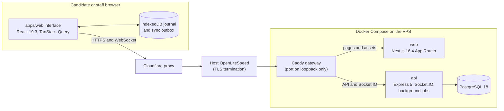
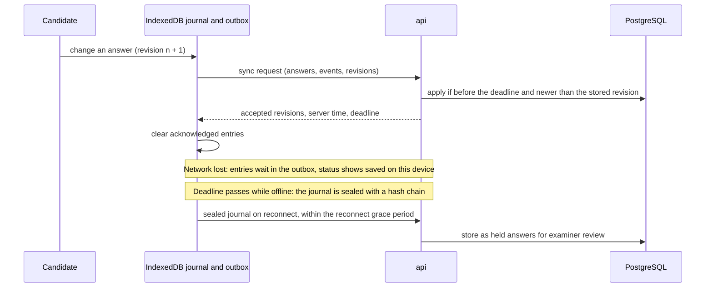

# Athena: Technical Analysis

- **Product:** Athena, a multi-tenant Secure Examination Management System
- **Team:** DevQueue
- **Event:** Technoverse 5.0 Web-e-Thon, COMSATS University Lahore, 27–28 November 2026
- **Companion:** [01-requirements-analysis.md](01-requirements-analysis.md) (requirement IDs FR, SF, IC, NFR, DEL and issue IDs A-nn used below)
- **Status:** analysis baseline, kept in step with the build. **Decided** means the item is part of our design decisions (the decision record, or the shared contracts and code already written). **Proposed** means this analysis recommends it, and it is confirmed or amended during the build. Figures marked *illustrative* are arithmetic, not measurements.

## How this document covers the evaluation criteria

| Criterion | Where it is addressed |
|---|---|
| Technical analysis | Sections 2 and 3 |
| Constraints | Section 3 |
| Technology selection reasons | Section 4 |
| Risks and their mitigations | Section 5 |
| Back-end architecture, design approach, OO design and best practices | Sections 2, 6 and 7 |
| Database design | Section 7.3 |
| Mapping design to code; the gap between code and design | Section 8 (module level, with the known differences) |

## Contents

1. [Summary](#1-summary)
2. [System context](#2-system-context)
3. [Constraints and their consequences](#3-constraints-and-their-consequences)
4. [Technology selection](#4-technology-selection)
5. [Risk register](#5-risk-register)
6. [Quality attributes](#6-quality-attributes)
7. [Architecture and design approach](#7-architecture-and-design-approach)
8. [Mapping design to code](#8-mapping-design-to-code)
9. [References](#9-references)

---

## 1. Summary

Athena must be trustworthy on hardware and networks it does not control, be built by a small team in ten hours, and run on a shared VPS with limited memory. Four design principles follow from that.

1. **The server is the authority.** Time, grading, answer keys, authorization and every state transition are decided on the server. The browser is never trusted with an outcome.
2. **The browser is local-first.** The candidate's device keeps working without a network and never loses work. It only holds that work until the server accepts it, and it can never extend its own time.
3. **Integrity is privacy-first.** Athena collects signals for humans to review. It does not watch candidates and it never issues an automated verdict.
4. **One contract serves both apps.** `packages/shared` defines the schemas, enums, permission keys and attempt contracts that `apps/web` and `apps/api` exchange, so a design change is a compile-time change everywhere it matters.

---

## 2. System context

- **Request path.**
  - Every request arrives at https://athena.devqueue.co, which Cloudflare proxies.
  - The host's OpenLiteSpeed proxy terminates TLS from Cloudflare, redirects plain HTTP to HTTPS and forwards to the Caddy gateway, passing WebSocket upgrades on the socket path (`docker/openlitespeed.vhost.conf`).
  - Caddy takes the visitor's address from `CF-Connecting-IP` (or `X-Forwarded-For` when the edge is bypassed), accepting it only from private-network peers, and routes pages to `web`, and API and Socket.IO traffic to `api` (`docker/Caddyfile`).
  - Only the gateway publishes a port, and only on the host's loopback interface. `web`, `api` and PostgreSQL are reachable only inside the Compose network, and only `api` talks to PostgreSQL.
- **Deployment.** One Docker Compose stack of four services: PostgreSQL 18, `api`, `web` and the Caddy gateway.
  - Every container has a memory limit and rotated logs, and restarts unless stopped. The `api` and `web` containers run as an unprivileged user.
  - PostgreSQL and the API have health checks.
  - In production, the API applies the versioned Drizzle migrations, then the idempotent trigger SQL, before it starts serving. Local development pushes the schema instead.
- **Background work.** It runs inside the `api` process: finalizing attempts at their deadline, and detecting the server's own downtime.
- **Shared code.** `packages/shared` is compiled into both apps. It holds:
  - the zod schemas, enums and permission keys;
  - the question-type contracts, with content, key and response kept apart;
  - the attempt and sync contract, the realtime event names and the workspace preferences;
  - the integrity primitives: the authorship provenance recorder and its replay, and the invisible paper fingerprint codec.
- **Two channels.**
  - The shared contract defines answer saving as a request/response sync exchange, separate from the Socket.IO event set. The sync exchange doubles as the heartbeat and carries the round-trip time.
  - Live monitoring, announcements and session takeover use Socket.IO events. The socket handshake authenticates the session cookie, and the server authorizes every room join. Socket.IO's own heartbeat (a ping every 10 s, 8 s timeout) notices a silent connection within about 18 s.
  - Sync is a plain HTTPS request (`POST /api/v1/attempts/:id/sync`), so losing the socket degrades live features but never saving.

---

## 3. Constraints and their consequences

| ID | Constraint | What it implies | Our response | Status |
|---|---|---|---|---|
| C-1 | 10-hour build, team of one to three | Hours spent on plumbing are lost to features; integration bugs found late are fatal | One TypeScript monorepo with one shared contract package; libraries that solve whole problems (accessibility, PDFs, reconnection); thin end-to-end slices | Decided |
| C-2 | No paid APIs, paid keys, proprietary data or specialized hardware (PDF §06) | Every feature must run on our own server | Ed25519 signing, QR codes, PDFs, analytics and similarity all computed locally; no email or SMS | Decided |
| C-3 | Shared VPS with limited memory, behind Cloudflare and two proxies | Memory spikes hurt neighbors; proxies affect client IPs, cookies and WebSockets | Four containers, each with a memory limit; no headless browser; bounded heavy work; proxy-aware configuration (section 3.2) | Decided; hashing and render bounds Proposed |
| C-4 | Slow venue network | Large bundles and chatty pages fail first, and the live demo depends on the network | Server-rendered shells, route-level code splitting, small sync payloads, local-first workspace; a phone hotspot as fallback | Decided; fallback Proposed |
| C-5 | Untrusted client device and clock | Anything computed or enforced on the client can be forged | The server owns time, grading, keys and authorization; client signals are only indicators (section 3.3) | Decided |
| C-6 | Flaky networks and power | Disconnection is normal, not exceptional | Local journal, revisioned outbox and an idempotent server; a sealed offline journal held for review; outage compensation (section 3.4) | Decided |
| C-7 | Thundering herd at exam start and at a shared deadline | Hundreds of sign-ins, starts and socket connections within a minute; hundreds of finalizations at one instant | Cheap, idempotent start; sign-in at the lobby before the window opens; bounded hashing; batched finalization; jittered retries (section 3.5) | Partly Decided; see R-12 to R-14 |
| C-8 | Privacy law and the ethics of proctoring | Surveillance data is sensitive, false accusations do harm, and some candidates live under strict data-protection law | No camera, microphone or screen recording; minimal, disclosed signals; indicators instead of verdicts; masked verification; a retention policy (section 3.6) | Decided; retention Proposed |
| C-9 | Many tenants in one database | One missing filter leaks another institution's data | The organization is resolved per request from the membership; services scope every query; permission middleware on every route | Decided |
| C-10 | Competition rules (PDF §07) | No change of any kind after the deadline; a 15-minute live demo | Deploy early and after every slice; seeded fictional data; a rehearsed demo path | Proposed (process) |

### 3.1 The 10-hour build (C-1)

- **One contract, three uses.** A zod schema in `packages/shared` drives three things at once: form validation in `apps/web`, request validation in `apps/api`, and the TypeScript types of both. A changed field cannot drift between client and server.
- **Libraries over plumbing.**
  - Radix primitives supply keyboard handling and ARIA.
  - Socket.IO supplies reconnection.
  - @react-pdf/renderer lays out PDFs.
  - Drizzle gives typed SQL without hiding transactions.
- **Build order.** The core exam workflow comes first, end to end. Then the secondary features, then the innovation challenges. Each is a thin slice through web, API and database, so the demo path always works (R-01).
- **Early deployment.** Deploying from the first hours removes deployment as a deadline risk (R-02).

### 3.2 Shared VPS, proxies and limited memory (C-3)

**Three layers** stand in front of the app: Cloudflare proxies the host, OpenLiteSpeed terminates TLS, then Caddy routes the request. Each layer has a consequence.

| Concern | Analysis | Response | Status |
|---|---|---|---|
| Client IP address | Behind proxies, the TCP peer is a proxy. Rate limits and the audit log would see one address for everyone. | Caddy reads the visitor's address from `CF-Connecting-IP` (falling back to `X-Forwarded-For`), accepts it only from private-network peers and forwards that single address. Express trusts only loopback, link-local and private-network hops, so a forged header from the internet is not trusted. | Decided |
| WebSockets | The upgrade must pass every proxy. | The edge passes WebSocket upgrades on the socket path, and Caddy proxies them natively. The client keeps Socket.IO's default transports, so it can run over HTTP long-polling when an upgrade is refused. Saving uses the separate HTTPS sync route, and announcements also arrive in sync responses. | Decided |
| Sibling subdomains | `SameSite=Lax` treats every subdomain of `devqueue.co` as the same site, so a compromised sibling app could send same-site requests that carry our cookie. | The API rejects any state-changing request whose `Origin` header names another origin. The session cookie is host-only (no `Domain` attribute). The `__Host-` cookie prefix would also stop a sibling from planting a cookie with the same name. | Origin check, host-only: Decided; prefix: Proposed |

**Memory**, on a VPS shared with other services:
- **PDFs.** @react-pdf/renderer lays out PDFs in-process, without a browser process per render. Concurrent renders should still be limited (R-28).
- **Password hashing.** Argon2id is memory-hard by design: each hash holds its configured memory while it runs, so peak hashing memory is the per-hash memory times the number of hashes running at once.
  - The API uses OWASP's profile (19 MiB, 2 iterations, parallelism 1). Four hashes at a time stay near 76 MiB (*illustrative*).
  - If 300 ran at once they would need about 5.6 GiB (*illustrative*), far above the API container's 768 MiB. Sign-in hashing therefore needs an explicit concurrency bound (R-14, Proposed). Bulk imports already hash through a small worker pool.
- **Process count.** One `api` process means Socket.IO rooms and background jobs need no cross-process coordination (no broker). Jobs must still be idempotent, because a restart can run them again; finalization is idempotent by design.
- **Container limits.** Each container has a memory limit, so the exam stack and its neighbors cannot starve each other.
  - PostgreSQL 1 GiB; `api` 768 MiB, with the V8 heap capped at 512 MiB; `web` 512 MiB, with the heap capped at 384 MiB; the gateway 128 MiB.
  - The stack stays within about 2.4 GiB, and each container keeps at most three 10 MB log files.

### 3.3 Untrusted client device and clock (C-5)

| The client could... | So the server... | Status |
|---|---|---|
| Move the device clock | Fixes the deadline at start, min(start + duration × accommodation multiplier + extra minutes, window close), and enforces it on every write. The client shows the countdown from the server time offset plus `performance.now()` and re-syncs on every response. Client timestamps are informational and never decide a deadline. | Decided |
| Look for answers in the bundle or the traffic | Never sends keys. Content, key and response are separate schemas, and each question type's handler produces the candidate-safe view. Parameterized answers are computed on the server. Socket payloads never carry keys or unpublished scores. | Decided |
| Forge requests or re-enable hidden controls | Authenticates and checks permissions in middleware and services, and validates every input on the server, whatever the client sends. | Decided |
| Fake or suppress integrity signals | Treats every signal as an indicator for human review, never a verdict. That is why the indicators carry review priorities, not penalties. | Decided |
| Replay, reorder or edit offline answers | Applies per-question revisions once and ignores stale ones. The offline journal is sealed with a SHA-256 hash chain and held for review. An HMAC receipt proves what was submitted. | Decided |

### 3.4 Flaky networks and power (C-6)

- **Detection.**
  - The browser's online flag reports only that a network interface is up, not that the server is reachable ([MDN][mdn-online]).
  - Connection state therefore comes from the sync exchange itself, which doubles as the heartbeat and reports the round-trip time to the monitoring view.
- **Exactly once.**
  - Every answer change carries a per-question revision that the client increments.
  - The server keeps the highest revision and ignores stale or repeated ones, so retries after a lost response are harmless.
- **Late answers.**
  - If the deadline passes while the candidate is offline, the server submits the attempt at its deadline with the answers it accepted, and the browser seals its journal.
  - The sealed journal is accepted only within the exam's reconnect grace period (default 15 minutes), once per attempt; the server stores the journal's chain digest with it.
  - Its answers are held for an examiner's decision with an audit entry and are never counted automatically.
- **Server outages.**
  - The API writes a heartbeat every 10 s. When it starts and finds the last heartbeat more than 30 s old, it records an outage and extends every attempt whose clock was running when the outage began by the outage's length, capped at 30 minutes, even past the window close. Each extension appears on the attempt's timeline and in the audit log, and the new deadline is pushed to the candidate and staff (`apps/api/src/modules/attempts/attempt.jobs.ts`).
  - Deadline checks wait until this compensation has run, so no attempt is submitted for time lost to the outage.
  - An outage upstream of a running API (the host proxy, the network) is not a server outage. For those, the connectivity timeline supplies the evidence, and staff can extend an attempt's time with a recorded reason.
- **Device handoff.** One session per attempt is active. Opening the attempt elsewhere takes over, and the old device is told and stops writing.

### 3.5 Thundering herd at start and at a shared deadline (C-7)

Illustrative load for 300 candidates in one exam:

| Moment | Load | Response | Status |
|---|---|---|---|
| Sign-in | 300 password hashes, often within a couple of minutes | Candidates sign in at the lobby before the window opens, which spreads the load; hashing concurrency is bounded (section 3.2) | Proposed |
| Exam start | 300 starts within about a minute, each assembling a paper and writing a snapshot | Assembly is seeded and bounded, the snapshot is written in one transaction, and a repeated or racing start resumes the same attempt (a partial unique index admits only one); clients retry with jittered back-off | Snapshot, repeated start: Decided; rest: Proposed |
| Autosave | 300 candidates syncing every ~10 s is ~30 small requests per second, each a few row writes guarded by deadline and revision | Light steady load; the risk is bursts and memory, not throughput | Analysis |
| Sockets | 300 long-lived connections, plus a reconnect storm after a network blip | Socket.IO's reconnection back-off includes randomization, which spreads reconnects | Decided |
| Edge connections | The edge proxy opens at most 200 connections to the gateway for ordinary HTTP traffic | Ample for short sync requests. A long-polling client holds one of them while it waits, so a mass fallback from WebSockets would compete with saves; the explicit upgrade path keeps fallback rare, and the limit can be raised | Analysis |
| Shared deadline | In a fixed sitting, every deadline falls at the same instant | Every 5 s the deadline sweep finalizes up to 100 expired attempts, oldest deadline first, each in its own transaction; finalization is idempotent, so an interrupted sweep simply resumes (`attempt.jobs.ts`) | Decided |
| Exam hall NAT | Every candidate in a hall shares one public IP | Sign-in limits are keyed by IP plus email (10 attempts a minute), and the global API ceiling by session, so one person cannot lock out a whole hall | Decided |

### 3.6 Privacy law and the ethics of proctoring (C-8)

Athena follows data minimization, purpose limitation, transparency and human review. These principles are shared by modern data-protection law, such as the EU GDPR, which can apply to a competition organizer whose participants live in the EU.

| Data | Purpose | Who sees it | Retention |
|---|---|---|---|
| Account data (name, email) | Identity and access | Staff of the organization | Life of the tenant |
| Answers, snapshots, scores, ledger, result versions | The academic record | The candidate (own, after publication); authorized staff | Life of the tenant (A-37) |
| Indicators: focus, fullscreen, copy and paste, context menu, print, multiple displays | Evidence for human review | Staff with integrity-review permission; the candidate's own dispute evidence | Until disputes and appeals close (Proposed, A-37) |
| Composition events of written answers | Authorship provenance (typed or pasted, bursts, replay) | Staff with integrity-review permission | As above |
| Connectivity timeline; browser, platform, screen and time zone at start | Technical evidence for disputes and fair treatment | Staff; dispute evidence | As above |
| Verification record | Proof that a report is authentic | Public, masked | While the report is valid |

Athena never collects:
- Camera, microphone or screen recordings.
- Biometrics.
- Content from outside the exam page.

Every page of the web app also carries a Permissions-Policy that turns off the camera, microphone and geolocation, so browsers that support the header refuse them even if a script asked.

AI-text detection is excluded on purpose. It has been shown to misjudge non-native English writing ([Liang et al., 2023][liang]), and most of our candidates write in a second language.

---

## 4. Technology selection

| Choice | Why (constraint or quality it serves) | Alternative considered |
|---|---|---|
| pnpm and Turborepo monorepo | One install and one repository; the shared package is consumed directly by both apps; Turborepo caches builds, type checks and tests; pnpm's strict `node_modules` rejects undeclared dependencies (C-1) | Separate repositories: contracts drift between client and server |
| TypeScript end to end | One language; shared types turn a contract mismatch into a build error (NFR-ARC-3) | Plain JavaScript: the same mistakes surface at run time |
| zod schemas in `packages/shared` | One definition serves form validation, API validation and types (NFR-VAL-1) | Separate validators that drift apart |
| Next.js 16.4 App Router, React 19.3 | Server-rendered shells for a fast first view on slow networks; route-level code splitting keeps the exam workspace light (C-4) | A client-only single-page app: slower first load and a larger bundle |
| Tailwind CSS 4 and Radix primitives | Radix supplies keyboard interaction, focus management and ARIA, so accessibility does not depend on hand-written widgets (NFR-UX-2). Tailwind design tokens keep one visual language, in an Apple-like style (NFR-UX-1, NFR-UX-6). | A ready-made component kit: the generic, template-like look PDF §08 warns against |
| TanStack Query | Caching, retries and background refresh; request and mutation states drive the visible loading, saving and failure feedback (NFR-VAL-5) | Hand-rolled fetch state on every screen |
| Motion | Interruptible, physically based transitions that respect reduced motion (NFR-UX-2, NFR-UX-6) | CSS transitions alone: hard to interrupt and coordinate |
| Express 5 | Minimal and widely known; rejected promises in async handlers reach the error handler without wrappers; helmet, rate limiting and pino plug in directly (C-1) | A heavier framework: more structure, but more setup than ten hours allow |
| Drizzle ORM | Schema in TypeScript, and queries that read like SQL; versioned migration files written by Drizzle Kit; transactions, row locks and raw SQL (the ledger trigger) are first-class (NFR-ARC-1) | ORMs that hide the SQL features we rely on |
| PostgreSQL 18 | Transactions and row locks for grading, remedies, imports and finalization; foreign keys, unique and partial unique indexes for invariants (one real attempt per candidate, sandbox attempts excluded); triggers for the append-only ledger; JSONB for snapshots and settings; exact `numeric` for marks (NFR-INT-1 to NFR-INT-4) | A document store: no cross-document constraints or triggers |
| Socket.IO | Rooms per exam and per attempt; automatic reconnection with randomized back-off; long-polling when a proxy refuses WebSockets (C-3, C-7) | Raw WebSockets: reconnection and fallback built by hand |
| Opaque server-side sessions | Revocable at once; a leaked database holds only token hashes; permission changes apply on the next request | JSON Web Tokens: not revocable without server-side state anyway, and claims go stale |
| argon2id | Memory-hard password hashing, OWASP's first choice ([OWASP][owasp]), used with OWASP's 19 MiB, 2-iteration profile | bcrypt: not memory-hard |
| @react-pdf/renderer | PDFs from React components on the server, without a headless browser (C-3) | Headless Chrome: a browser process per render on a memory-limited VPS |
| Ed25519 (Node.js `crypto`) | Small, fast signatures, built in; no external signing service (C-2) | A hosted signing service: external and possibly paid |
| IndexedDB | Durable, transactional and asynchronous browser storage that survives refresh, crash and restart (C-6) | `localStorage`: synchronous, small, no transactions |
| pino and helmet | Structured, low-overhead logs that support redaction of secrets; secure HTTP headers by default (NFR-SEC-4) | Ad-hoc logging and hand-set headers |
| Docker Compose and Caddy, behind the host's OpenLiteSpeed | A reproducible four-service deployment on the shared VPS, with a memory limit per container and only a loopback port exposed; Caddy serves web and API under one origin, so the session cookie is first-party (C-3) | Hosted platforms: external accounts, billing details or cold starts during an exam |

---

## 5. Risk register

Likelihood (L) and impact (I) are rated High, Medium or Low.

| ID | Risk | L | I | Mitigation | Status |
|---|---|---|---|---|---|
| R-01 | Scope exceeds the ten hours (24 FR, 8 SF, 5 IC) | H | H | Build the core workflow end to end, then the secondary features, then the innovations, each as a thin slice; cut depth, not breadth; keep the demo path working at all times | Proposed (process) |
| R-02 | Deployment breaks near the deadline, when no further deploy is allowed | M | H | Deploy from the first hours and after every slice; final deploy well before the cut-off. Health checks on the database and the API; the API applies migrations before it serves and exits if one fails, so a bad migration shows at once instead of running against the wrong schema | Process: Proposed; migrations at start, health checks: Decided |
| R-03 | Venue network slow or down during the demo | M | H | Phone hotspot as fallback; small bundles; the local-first workspace keeps working, and its offline path is part of the demo | Proposed (process) |
| R-04 | Cross-tenant data leak through a missing scope check | M | H | The organization is resolved per request from the membership; services scope every query; permission middleware on every route; refusal tests for each role (`apps/api/test/01-access-control.e2e.test.ts`) | Decided |
| R-05 | Answer keys exposed to candidates | M | H | Keys stored apart from content; candidate-safe views from each type's handler; socket payloads never carry keys or unpublished scores; parameterized answers computed on the server | Decided |
| R-06 | Device clock changed to gain time | H | H | Server-fixed deadline enforced on every write; countdown from the server offset plus `performance.now()` | Decided |
| R-07 | Answers lost to a crash, refresh or power cut | H | H | IndexedDB journal written on every change; revisioned outbox; idempotent server | Decided |
| R-08 | The newest keystrokes are lost because the browser had not yet flushed storage when power failed | M | L | Request strict durability for journal writes where the browser supports it; at worst the last moments of typing are lost, not the attempt | Proposed |
| R-09 | Offline candidates gain extra time | M | H | Answers that arrive after the deadline are never auto-counted; the sealed, hash-chained journal is accepted only within the reconnect grace period and is held for an examiner's decision, with an audit entry | Decided |
| R-10 | A server outage costs candidates time | L | H | Heartbeat-based detection at API start (a gap over 30 s); attempts whose clocks were running get the outage's length back, capped at 30 minutes, as audited extensions; upstream outages are covered by the connectivity timeline and by staff extensions with a recorded reason | Decided |
| R-11 | Race between a candidate's submit and the deadline job | M | M | Finalization is idempotent and returns the same result; every write checks the deadline, so an expired attempt cannot change even before the job reaches it | Decided |
| R-12 | Sign-in and start storm when the window opens | M | H | Sign-in at the lobby before the window opens; bounded start work in one transaction; idempotent start; jittered retries (saves back off exponentially from 1 s to 30 s with random jitter) | Snapshot, idempotent start, jittered save retries: Decided; rest: Proposed |
| R-13 | IP-only rate limits lock out a whole exam hall behind one NAT address | M | H | Sign-in limits are keyed by IP plus email, and the global API ceiling (1,200 requests a minute) by session, falling back to IP only for anonymous requests | Decided |
| R-14 | Argon2id memory spike during a sign-in burst | M | M | OWASP profile (19 MiB, 2 iterations, parallelism 1) in code; an explicit bound on concurrent sign-in hashes, so peak memory is fixed; imports already hash through a small worker pool | Profile, import pool: Decided; sign-in bound: Proposed |
| R-15 | A proxy refuses the WebSocket upgrade | L | M | The edge passes upgrades on the socket path explicitly; Socket.IO falls back to long-polling (the client keeps the default transports); saving uses the separate sync contract; announcements also arrive in sync responses. A mass fallback would hold many of the edge's 200 gateway connections (section 3.5) | Decided |
| R-16 | Rate limits and the audit log see the proxy's address | M | M | Caddy accepts forwarded addresses only from private-network peers, and Express trusts only loopback, link-local and private-network hops, so the client address comes from the forwarded chain | Decided |
| R-17 | Cross-site request forgery from a sibling subdomain (`SameSite=Lax` treats all of `devqueue.co` as one site) | L | H | State-changing requests whose `Origin` header names another origin are rejected; host-only session cookie; `__Host-` prefix as further hardening | Decided; prefix: Proposed |
| R-18 | Session token theft or fixation | L | H | httpOnly cookie, Secure in production; random 256-bit token stored only as a SHA-256 hash; sessions expire; instant revocation; helmet headers on the API; a Content Security Policy, frame denial and HSTS on the web app | Decided |
| R-19 | Credential stuffing or brute force | M | M | Sign-in rate limited per IP and email; five consecutive failures lock the account for 15 minutes; argon2id; an unknown email costs the same hashing work as a wrong password, so timing reveals nothing (a locked account is the exception, R-32); failed sign-ins audited | Decided |
| R-20 | Examiner-written formulas (parameterized numeric questions) run code on the server | L | H | Evaluate with an expression library (mathjs `evaluate` in `domain/question-types/numeric.ts`), never with `eval`; restrict it to arithmetic over the declared variables; cap formula length | mathjs evaluation: Decided; restriction and length cap: Proposed |
| R-21 | Indicators cast suspicion on honest candidates (unstable Wi-Fi, assistive technology, notifications that steal focus) | H | M | Indicators only, with a review priority and context; no automatic sanction; a human records the outcome; recorded signals are disclosed in the charter | Decided |
| R-22 | Collusion or similarity analytics flag legitimate overlap (textbook phrasing, short answers, a popular wrong option) | M | M | Count only uncommon wrong answers (given by at most 15 % of respondents), weight them by rarity and rank pairs by z-score against every other pair; ignore text every candidate was given; label results as indicators for human review | Decided |
| R-23 | The leak fingerprint is lost (retyped text, photos, OCR) | H | M | The visible watermark code survives screenshots and photos; the codec also detects a damaged fingerprint, which still shows that a copy came from an Athena rendition; per-attempt question selection and order narrow the source; exposure tracking and the review warning on traced questions help retire leaked questions | Decided |
| R-24 | Zero-width characters disturb screen readers, search or copying | M | M | When watermarking is on (the default), one fingerprint per question stem, placed right after its first sentence and never inside a word, math or code; check the candidate view with a screen reader | Placement: Decided; screen-reader check: Proposed |
| R-25 | Someone with database access tampers with the grade ledger | L | H | A row-level trigger rejects UPDATE and DELETE. Each row's hash covers the previous row's hash and is keyed with a server secret, so a database-only attacker cannot rewrite the chain consistently, and recomputing the chain reveals any edit. The hash is taken over canonical JSON (keys sorted, scores rounded to the stored three decimals), so verification recomputes exactly what was hashed, although jsonb reorders keys. **Residual risk:** row-level triggers do not fire on TRUNCATE, which the seed script uses for resets. In production, the application's database role should lose TRUNCATE on the ledger, or a statement-level guard should be added. | Decided; TRUNCATE guard: Proposed |
| R-26 | Inconsistent scores after a remedy or regrade | M | H | Grading and rubric re-scoring run in transactions that lock the affected answers; item scores and totals are recomputed together; a dropped question is voided, not deleted; impact preview first; a remedy applies in one transaction across every affected attempt, and is refused if scores changed since the preview; one ledger entry per change | Decided |
| R-27 | Floating-point drift in totals | M | M | Marks stored as exact decimals; each item rounded once to three places; the total summed from items and floored at 0 | Decided |
| R-28 | PDF rendering exhausts memory or CPU | M | M | @react-pdf/renderer instead of a headless browser; render on request; limit concurrent renders | Library: Decided; limit: Proposed |
| R-29 | A malformed or very large import file | M | M | Dry run with row-level errors; request size limits (2 MB JSON, 5 MB CSV) and row limits (1,000 people, 500 questions); a single-transaction commit that validates every row again and never writes a row with errors | Decided |
| R-30 | A shared lab computer keeps the previous candidate's journal | M | M | The journal is keyed by attempt and cleared as soon as the server's submission receipt arrives (`features/workspace/sync/engine.ts`) | Decided |
| R-31 | Verification codes guessed or enumerated | L | M | Random codes with 60 bits of entropy (`ATH-XXXX-XXXX-XXXX`); a uniform "not found"; the public endpoints limited to 30 requests a minute; masked minimal data on the page | Decided |
| R-32 | Targeted lockout: anyone who knows a candidate's email can lock the account for 15 minutes with five wrong passwords just before an exam, and the lock notice confirms that the account exists | M | M | Existing sessions are unaffected, so candidates who sign in at the lobby early are safe (R-12); an Organization Admin's password reset clears the lock at once. Further: a staff unlock that keeps the password, a progressive delay instead of a hard lock, and the same response for a locked and an unknown account | Reset: Decided; rest: Proposed |
| R-33 | A leaker plants another candidate's visible code in leaked text to frame them | L | H | Codes are random six-character values, unique per attempt, so planting one needs another candidate's screen. A trace is evidence for review, never a verdict; the reviewer compares the leaked text with the traced attempt's snapshot (which questions, in which order, with which values) before drawing any conclusion | Review principle: Decided; snapshot comparison: Proposed |
| R-34 | Script injection through examiner-written question text or candidate answers | L | H | React escapes rendered text, and the web app inserts raw HTML only for its own static theme script; the Content Security Policy limits scripts to our origin and forbids framing. The policy still allows inline scripts for that theme script; a hash for it would let the policy drop `'unsafe-inline'` | Decided; script hash: Proposed |

---

## 6. Quality attributes

Each attribute is stated as a scenario with a checkable response. The architecture column names the mechanism that delivers it.

| Attribute | Scenario and expected response | How the architecture achieves it | Requirements |
|---|---|---|---|
| Security (authorization) | A candidate replays a staff request with curl: it is refused, and no data comes back. | Session, organization and permission checks in middleware on every route; exam-assignment checks in services; the same session check on the socket handshake and on every room join; the interface reads permissions only to decide what to show | NFR-SEC-1, FR-3.1.3 |
| Confidentiality of keys | A candidate inspects every response during an attempt: no correct answer appears. | Content, key and response are separate schemas; keys stored apart; per-type candidate-safe views; parameterized answers computed on the server | NFR-SEC-3 |
| Timing integrity | The device clock is moved by an hour mid-attempt: the remaining time shown barely changes, and the server deadline does not change at all. | Server-fixed deadline; enforcement on every write; offset plus monotonic clock, re-synced on every response | NFR-INT-1, IC-5.3 |
| Grading integrity | A remedy changes 300 attempts: all change or none do, and each change appears in the ledger. | Transactions; recomputation of items and totals together; keyed, hash-chained, append-only ledger with a database trigger | NFR-INT-3, IC-5.4 |
| Resilience | Power is cut mid-answer: after restart, the journal replays, and the server holds every journaled answer exactly once. | IndexedDB journal; revisioned outbox; idempotent server; sealed offline journal | IC-5.3, NFR-VAL-3 |
| Availability | The API restarts during an exam: candidates keep typing, saves resume by themselves, and deadlines are extended by the verified outage. | Local-first client; heartbeat-based outage compensation; sessions, attempts and deadlines live in PostgreSQL, not in process memory | IC-5.3 |
| Performance under bursts | 300 candidates start within one minute: every start succeeds once, and retries are harmless. This is a target, not a measured claim. | Bounded start work; one transaction per start; idempotent start; jittered retries | C-7 |
| Usability and accessibility | A keyboard-only candidate with a 1.5× time accommodation completes an exam at 200 % zoom. | Radix primitives; design tokens; workspace preferences on the profile; accommodations applied at start | NFR-UX-2, SF-4.7 |
| Privacy | A candidate sits an exam: no camera or microphone access is requested and the screen is not recorded. Public verification shows only masked data. | Privacy-first integrity; a Permissions-Policy that turns off camera and microphone; minimal, disclosed data; masked verification page | IC-5.1, SF-4.6, NFR-SEC-5 |
| Accountability | A score changed last week is questioned: the ledger shows who changed it, when, why, and from what to what, and the chain check confirms the history. | Ledger entries with actor, reason and previous and new score; audit log for security-relevant actions; HMAC submission receipts | NFR-SEC-6, IC-5.4 |
| Fairness | An exam draws 10 of 30 questions per section: every paper's expected score is within 3 % of total marks of the target, and papers still differ. | Bayesian difficulty estimates; seeded, stratified assembly; swap optimizer; pre-publication simulation | IC-5.2 |
| Modifiability | A new auto-graded question type is added: one handler and its schemas are registered, and the grading engine and other types are untouched. | Strategy pattern with a registry (open/closed principle) | NFR-ARC-2 |
| Testability | The marking rules are verified without a server or database. | Handlers and the phase and deadline rules are plain functions; seeded randomness makes papers reproducible; unit tests assert the key marking cases listed in 01, section 2.4 | NFR-ARC-3, FR-3.7.1 |
| Deployability | From a fresh VPS, the stack starts with Docker Compose, migrations and the ledger trigger are applied, and demo data is seeded. | Four-service Compose file with health checks; the API applies the versioned Drizzle migrations and the idempotent trigger SQL when it starts in production (local development pushes the schema); seed script | DEL-7.1, DEL-7.3 |

---

## 7. Architecture and design approach

### 7.1 Design approach

1. **The server is the authority.** Deadlines, grading, keys, authorization and state transitions are decided only on the server.
2. **The browser is local-first.** It holds work and shows status. It never decides an outcome.
3. **Integrity is privacy-first.** Signals go to humans, nothing is surveilled, and no verdict is automated.
4. **One contract serves both apps.** `packages/shared` is the single source of truth for what web and API exchange.
5. **Defense in depth.** Important rules are enforced at more than one layer: form, API schema, service rule, and database constraint or trigger (01, section 2.10).
6. **Explicit state machines.** Exam phase, attempt status, result publication and disputes permit only their defined transitions.

### 7.2 Back-end structure and patterns

- **Request layers.** A request passes through these layers in order:
  1. Request context and structured logging.
  2. Security headers (helmet) and body parsing with size limits.
  3. Origin check.
  4. Authentication (session lookup by token hash).
  5. Rate limiting.
  6. Feature routes with their permission guards.
  7. Feature services.
  8. Domain rules (question types, grading, ledger, seeded randomness).
  9. Data access (Drizzle).
  
  A not-found handler and a central error handler end the chain, so failures are reported the same way everywhere.
- **Adapters alongside the request path.**
  - Socket.IO for monitoring, announcements and session takeover.
  - The background jobs for finalization and outage detection.
- **Feature areas.** The feature services are grouped by area: identity and tenancy, questions, exams, attempts, monitoring, grading, results, analytics, reports, disputes, integrity and fairness.

| Pattern or practice | Where | Why |
|---|---|---|
| Strategy, with a registry | Question types: one handler per type validates content, produces the candidate-safe view, validates the response and auto-grades | New types without touching the engine (open/closed); keys never leak by accident |
| State machine and guard | Exam phase (derived from server time), attempt status, result publication, dispute lifecycle; a lock on an exam's structure, timing and delivery settings after its first real attempt (the window close can still move later) | Invalid transitions are impossible, not just discouraged |
| Immutable versions and snapshots | Bank questions are immutable versions that exams pin; each attempt copies its questions, marks, scheme and key at start | Edits never reach a live exam, and active attempts keep their assignment and marking scheme (NFR-INT-4) |
| Append-only, hash-chained log | Grade ledger | Accountability and tamper evidence for every score change |
| Outbox and idempotent receiver | Client journal with per-question revisions; idempotent finalization | Exactly-once effect over an unreliable network |
| Middleware chain | Context and logging, security headers, origin check, authentication, rate limiting, permission guards, error handling | One place for each cross-cutting concern |
| Shared contract | zod schemas, enums and permission keys in `packages/shared` | Front-end and back-end validation cannot drift |
| Shared pure primitives | Provenance recorder and replay, and the fingerprint codec, in `packages/shared` | The workspace that records and the staff tools that read run the same code, so the format cannot drift; testable without a browser |
| Optimistic concurrency and row locks | A stale question save gets a version conflict; an exam is locked while it is published or restructured, and answers while a rubric change re-scores them | Two staff members working at once never overwrite each other's work |
| Seeded randomness | Paper assembly, option order, parameterized values | Reproducible papers for refresh, device change, disputes and tests |

### 7.3 Database design decisions

- **Tenancy.** Every tenant-owned record belongs to one organization, and every query is scoped by the active organization. Identity is global: one user, with a membership (and role) per organization, plus exam-level staff assignments.
- **Questions.** Questions are stored as immutable versions, and each exam pins the version it uses. Each version keeps candidate-visible content and the answer key in separate columns, and candidate-facing queries never select the key.
- **Exams.** Settings are stored as validated JSON with safe defaults, so adding a setting needs no migration and every exam has a complete configuration.
- **Attempts.**
  - Each attempt stores its own items: the snapshot of questions with their marks, method marks, candidate-safe content and a server-only key for that variant.
  - A remedy that drops a question sets a void reason on the item instead of deleting it. The item then leaves the score and the maximum, grading queues, results statistics and analytics, and candidates see the reason.
  - Each attempt also stores its expected paper score from the fairness engine, its deadline, its status and why it was submitted.
- **Answers.** Each answer keeps auto, manual and method-mark scores separately, with the rubric items applied, each grader's adjustment and its revision. Recomputing a total is therefore a pure function of stored parts, and a rubric edit re-scores exactly. An answer also holds its authorship provenance, and any offline entry that arrived after the deadline, held for an examiner's decision.
- **Exactness.** Marks are exact decimals (`numeric`), and instants are timestamps with time zone.
- **Migrations.** Drizzle Kit writes every schema change as a versioned migration file, stored with the code. Production applies them when the API starts, followed by the idempotent trigger SQL; local development pushes the schema directly.
- **Ledger.** It has a global sequence, the previous row's hash and a keyed hash, actor, reason, and the previous and new scores. The hash is an HMAC over canonical JSON: keys are sorted at every level, because jsonb reorders them, and scores are rounded to the stored precision, so recomputing the chain from stored rows gives the same digests. The chain check reports the first broken entry. A row-level trigger rejects UPDATE and DELETE (see R-25 for TRUNCATE).
- **Operational state.** The API heartbeat and verified outages are stored in the database, so outage compensation survives a restart.
- **Reports.** Issued reports have a status (valid, superseded or revoked) for verification.
- **Invariants.** Constraints enforce what the database can express: one membership per user per organization, one enrollment per candidate per exam, one real attempt per candidate per exam (a partial unique index that ignores sandbox attempts), one answer per attempt item, and one version number per question.

---

## 8. Mapping design to code

The mapping is at module level. Paths are relative to each package's `src` folder. Where the code carries a requirement ID from 01, such as the shared preferences schema (SF-4.7) or the offline journal (IC-5.3), a search finds the link.

| Requirement group | `packages/shared/src` | `apps/api/src` | `apps/web/src` |
|---|---|---|---|
| FR-3.1 Authentication and authorization | `permissions.ts`, `enums.ts` | `modules/auth`, `middleware/authenticate.ts`, `guards.ts`, `origin-check.ts`, `modules/org`, `modules/platform`, `modules/audit` | `app/sign-in`, `components/shell/org-switcher.tsx`, `config/navigation.ts`, `features/admin` |
| FR-3.2 Exam management | `exam-settings.ts`, `exam-phase.ts` | `modules/exams` (`exams.service.ts`, `exam-review.ts`, `exam-structure.service.ts`, `exam-settings-merge.ts`) | `features/authoring/exams` (wizard, overview, publish dialog) |
| FR-3.3 Question management | `question-types.ts` | `domain/question-types` (`registry.ts` and one handler per family), `modules/questions` | `features/authoring/questions` |
| FR-3.4 Candidate management | `attempt-contract.ts` | `modules/exams/enrollments.service.ts`, `modules/attempts/candidate-exams.service.ts` | `features/candidate` (home, lobby, charter) |
| FR-3.5 Examination interface | `attempt-contract.ts`, `preferences.ts` | `modules/attempts` (`attempt.service.ts`, `attempt.policy.ts`, `attempt.jobs.ts`, `deadline-gate.ts`) | `features/workspace` (`sync/`, `components/`, `renderers/`) |
| FR-3.6 Monitoring | `realtime-events.ts` | `modules/monitoring`, `realtime/` | `features/monitoring` |
| FR-3.7 Grading | `enums.ts` | `modules/grading`, `domain/grading`, `domain/ledger` | `features/grading` |
| FR-3.8 Results and analytics | `enums.ts` | `modules/results`, `modules/analytics`, `domain/analytics` | `features/results`, `features/analytics` |
| SF-4.1 Network-aware interface | `attempt-contract.ts` | `modules/attempts` (sync route) | `features/workspace/components/sync-pill.tsx`, `banners.tsx` |
| SF-4.2, SF-4.6 Reports and verification | | `modules/reports` (`pdf/`, `signing.ts`, `report-status.ts`) | `features/results`, `app/verify/[code]` |
| SF-4.3 Sandbox | | `modules/attempts/attempt.service.ts` (sandbox start and discard), `db/scopes.ts` | `features/authoring/exams/exam-overview.tsx` |
| SF-4.4 Bulk import | | `modules/questions/question-import*.ts`, `modules/org/people-import.service.ts`, `modules/exams/enrollment-import.ts` | `features/admin/people/import-view.tsx`, `features/authoring/questions/question-import.tsx`, `features/authoring/exams/candidate-import-dialog.tsx` |
| SF-4.5 Question analytics | | `domain/analytics`, `modules/analytics` | `features/analytics` |
| SF-4.7 Customizable workspace | `preferences.ts` | `modules/auth` (`PATCH /auth/me/preferences`) | `features/workspace/components/preferences-sheet.tsx`, `features/workspace/lib/preferences.tsx` |
| SF-4.8 Scratchpad | | `db/schema/attempts.ts` (scratchpad pages) | `features/workspace/tools` (`scratchpad.tsx`, `calculator.tsx`) |
| IC-5.1 Integrity | `integrity.ts` (provenance recorder and replay) | `domain/integrity` (`indicators.ts`, `similarity.ts`), `modules/integrity` | `features/integrity`, `features/candidate/integrity-charter.tsx`, `features/workspace/lib/integrity.ts` |
| IC-5.2 Fairness | | `domain/paper`, `modules/fairness` | `features/fairness` |
| IC-5.3 Resilience | `attempt-contract.ts` | `modules/attempts` (`offline-journal.service.ts`, `attempt.jobs.ts`) | `features/workspace/sync` (`journal.ts`, `engine.ts`, `clock.ts`, `hash-chain.ts`), `features/attempts/offline-held-review.tsx` |
| IC-5.4 Disputes | | `modules/disputes` (`dispute.policy.ts`, `evidence.ts`, `remedies.service.ts`), `domain/ledger`, `db/sql/001_grade_ledger_guard.sql` | `features/disputes` |
| IC-5.5 Leak tracing | `integrity.ts` (fingerprint codec) | `domain/integrity/leak.ts`, `modules/integrity/leak.service.ts` | `features/integrity/components/leak-tracer.tsx` |
| NFR (all) | Shared schemas | `middleware/`, `lib/validate.ts`, `lib/errors.ts`, `db/schema`, `db/sql` | Forms validated with the shared schemas, status feedback |

**Keeping design and code aligned.**
- **Contracts first.** A design change starts as a change to `packages/shared`, and the compiler then lists every place it touches.
- **The docs follow the code where the build refines the brief or the design.** Both documents already reflect these refinements:
  - Negative marking also applies to true/false.
  - "Partial" multiple-select gives zero when any wrong option is picked.
  - Disputes have *appealed* and *closed* states.
  - Bank questions are immutable versions pinned by exams. This replaces refusing edits to a question that a locked exam uses.
  - A rubric award is clamped to the part's range and stores the grader's adjustment, so a rubric edit re-scores exactly; only a typed score outside the range is refused.
  - An import with errors can still commit its valid rows (for people, only by explicit choice), instead of committing only after a clean dry run.
  - A dropped question is voided on each attempt, not deleted.
  - Results publication is refused while the checklist has blockers, but a publisher can override with a recorded reason (A-32).
  - Insights need five graded answers, not the twenty first proposed (A-42).
  - After candidates start, the window close can still move later; everything else about the paper and its timing is locked (A-14).
  - The ledger hash is taken over canonical JSON. Hashing the stored object directly would fail verification on correct rows, because jsonb reorders keys and scores are stored to three decimals.
- **Known gap.** The workspace already validates responses, sync payloads and provenance with the shared schemas. Some request schemas, such as the exam fields and their timing check, still live only in the API module, while NFR-VAL-1 asks for one shared schema wherever a form applies the same rule (Proposed: move them to `packages/shared`).
- **Remaining differences.** Checked against the code at submission:
  - The attempt status enum has an *awaiting sync* value, but the API never sets it: an attempt whose time runs out offline is submitted at its deadline, and its sealed journal's newer answers are then held on the answer rows.
  - Outage compensation is capped at 30 minutes per outage and is computed when the API starts.
  - The server stores the sealed journal's chain digest but does not recompute it; the chain makes tampering detectable on review, not on upload.
  - Writes from a superseded device are refused rather than held (A-25).
  - Still open: the `__Host-` cookie prefix (the cookie is `athena_session`), a bound on concurrent sign-in hashing (R-14), strict IndexedDB durability (R-08), a limit on concurrent PDF renders (R-28), a TRUNCATE guard on the ledger (R-25), a script hash in the Content Security Policy (R-34), and the accommodation warning on the review screen (A-11).

---

## 9. References

1. [OWASP Password Storage Cheat Sheet][owasp]: Argon2id with at least 19 MiB of memory, 2 iterations and parallelism 1.
2. [MDN, `Navigator.onLine`][mdn-online]: the online flag does not guarantee internet access.
3. [Socket.IO, "How it works"][sio]: transports, upgrade and reconnection.
4. [Liang et al., 2023][liang]: "GPT detectors are biased against non-native English writers", *Patterns*.
5. [W3C, WCAG 2.2][wcag].

[owasp]: https://cheatsheetseries.owasp.org/cheatsheets/Password_Storage_Cheat_Sheet.html
[mdn-online]: https://developer.mozilla.org/en-US/docs/Web/API/Navigator/onLine
[sio]: https://socket.io/docs/v4/how-it-works/
[liang]: https://arxiv.org/abs/2304.02819
[wcag]: https://www.w3.org/TR/WCAG22/
